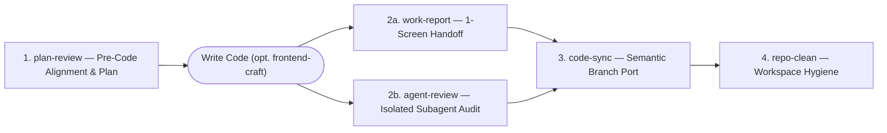

# Ainward Skills

English | [简体中文](README.zh-CN.md)

Low-cognitive-load, codebase-grounded, sharply scoped [Agent Skills](https://agentskills.io) for software engineering—compatible with Antigravity, Claude Code, Codex, OpenCode, and Cursor.



---

## Core Lifecycle Workflows (5 Explicit On-Demand Skills)

| Skill | One-Sentence Role | Triggers | Docs |
|-------|-------------------|----------|------|
| **[plan-review](skills/plan-review/README.md)** | Reads the real codebase first, restates the root problem and goal in 2–3 plain sentences (exposing XY mismatches with code links), asks only true blocking forks, and delivers a self-contained complete execution plan (file/contract inventory, ordered steps `1..N`, runnable verification). | `/plan-review`, `"plan review"`, `"align requirements"`, `"in-your-own-words"`, `"方案评审"`, `"需求纠偏"` | [Docs →](skills/plan-review/README.md) |
| **[work-report](skills/work-report/README.md)** | Delivers a single-screen functional walkthrough of completed changes with clickable file-line links, candid `⚠️` shortcuts/assumptions, and real verification status. | `/work-report`, `"work report"`, `"walk me through the changes"`, `"brief me on the changes"`, `"向我汇报"` | [Docs →](skills/work-report/README.md) |
| **[agent-review](skills/agent-review/README.md)** | Dispatches an unbiased read-only subagent across upstream callers, downstream side effects, and shared peers (`"fix A, break B"`), finishing in 3 lines on `Pass` or offering a 1-click `P0/P1` fix loop. | `/agent-review`, `"agent review"`, `"code review"`, `"review my changes"`, `"审查一下"`, `"独立审查"` | [Docs →](skills/agent-review/README.md) |
| **[code-sync](skills/code-sync/README.md)** | Ports scoped changes across branches by engineering intent with bidirectional parallel isolation, adapting to target architecture in an isolated `worktree` when needed. | `/code-sync`, `"code sync"`, `"sync to branch"`, `"port changes to"`, `"semantic merge"`, `"代码同步"` | [Docs →](skills/code-sync/README.md) |
| **[repo-clean](skills/repo-clean/README.md)** | Scans repo and linked `worktree` checkouts offline—separating 100% deterministic `🟢` cleanups from AI-digested 1-line `🟡` calls, backed by OS Trash and Commit SHA recovery. | `/repo-clean`, `"repo clean"`, `"clean workspace"`, `"cleanup leftovers"`, `"清理仓库"`, `"清理工作区"` | [Docs →](skills/repo-clean/README.md) |

## Optional Domain Craft Spec (Auto-Triggered on UI Build/Refactor)

| Skill | One-Sentence Role | Triggers | Docs |
|-------|-------------------|----------|------|
| **[frontend-craft](skills/frontend-craft/README.md)** | Single-file, zero-extra-I/O frontend visual, cross-page consistency, and state guardrail—scaling recon to change scope while enforcing 3-tier tokens, table/modal contracts, 5-state async UX, CJK IME safety, and anti-AI-slop rules. | Auto-triggers when building/rebuilding UI components & pages, or `/frontend-craft`, `"frontend craft"`, `"ui spec"`, `"前端规范"`, `"去 AI 味"` | [Docs →](skills/frontend-craft/README.md) |

---

## Quick Start & Installation

### Option 1: Install via `npx skills`

```bash
npx skills add lastxuanain/ainward-skills
npx skills update   # Pull updates later
```

### Option 2: Git Clone + `scripts/link.sh` (Recommended for instant `git pull` updates)

```bash
git clone https://github.com/lastxuanain/ainward-skills.git ~/ainward-skills

# Auto-detect installed agents (Antigravity, Claude Code, Codex, OpenCode, Cursor) and symlink all skills
~/ainward-skills/scripts/link.sh

# Backend/infra-only setups can exclude frontend-craft, link specific skills, or inspect status
~/ainward-skills/scripts/link.sh --exclude frontend-craft --prune
~/ainward-skills/scripts/link.sh --skills plan-review,agent-review,code-sync
~/ainward-skills/scripts/link.sh --status
```

---

## Design Philosophy

- **Proposal & Result First (Low Cognitive Load)**: Eliminates multi-round multiple-choice interrogations and boilerplate walls—owning clear-winner trade-offs autonomously, fast-pathing conflict-free work, and pausing only on genuine forks or risks.
- **Codebase-Grounded Evidence**: Backs course corrections, walkthroughs, and bug findings with clickable file-line links; marks unrun checks honestly as `Not verified` instead of fabricating passes.
- **Isolated Verification & Parallel Safety**: Strips implementer confirmation bias via isolated read-only subagents and prevents multi-session bleed via hard scope allowlists and sibling `git worktree` carriers.

---

## Repository Structure & License

```text
ainward-skills/
├── scripts/
│   └── link.sh             # Multi-agent symlink sync, filtering & stale-link cleanup
└── skills/
    └── <skill-name>/
        ├── SKILL.md        # Concise single-file agent instructions
        ├── README.md       # English guide
        └── README.zh-CN.md # Chinese guide
```

Issues and PRs are welcome at [GitHub Issues](https://github.com/lastxuanain/ainward-skills/issues). Released under the **[MIT License](LICENSE)**.
