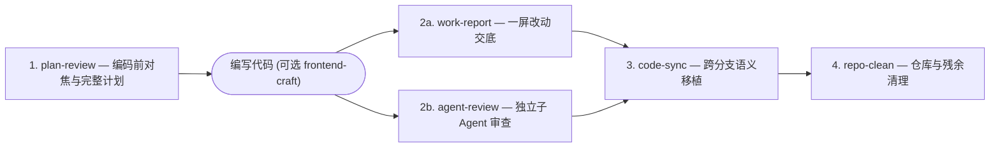

# Ainward Skills

[English](README.md) | 简体中文

一套**极低认知负担、基于真实代码证据、边界锋利**的开源工程化 [Agent Skills](https://agentskills.io)，兼容 Antigravity、Claude Code、Codex、OpenCode 与 Cursor。



---

## 核心研发闭环工作流（5 个按需显式触发）

| Skill | 一句话定位 | 触发方式 | 文档 |
|-------|------------|----------|------|
| **[plan-review](skills/plan-review/README.zh-CN.md)** | 动笔前先读源码，用 2–3 句大白话还原真实痛点与目标（破除 XY 问题、带代码定位纠偏），仅对真分歧提问，交付自包含完整执行计划（全量文件与契约清单、有序步骤 `1..N`、可执行验收方案）。 | `/plan-review`、`"方案评审"`、`"需求纠偏"`、`"对齐需求"`、`"复述需求"`、`"in-your-own-words"` | [详情 →](skills/plan-review/README.zh-CN.md) |
| **[work-report](skills/work-report/README.zh-CN.md)** | 改完代码后一屏按功能模块讲清改了什么（附可点击文件行号链接），主动用 `⚠️` 坦白临时变通与隐式假设，如实汇报验证结果。 | `/work-report`、`"向我汇报"`、`"工作汇报"`、`"汇报一下这次改动"` | [详情 →](skills/work-report/README.zh-CN.md) |
| **[agent-review](skills/agent-review/README.zh-CN.md)** | 派发零偏见独立只读子 Agent 沿上下游调用方与横向复用链排查“修 A 坏 B”与静默吞错，`Pass` 3 行收工，检出 `P0/P1` 提供一键修复闭环。 | `/agent-review`、`"审查一下"`、`"独立审查"`、`"代码审查"` | [详情 →](skills/agent-review/README.zh-CN.md) |
| **[code-sync](skills/code-sync/README.zh-CN.md)** | 严格隔离并行会话范围，按工程意图向目标分支最新架构重适配并跑靶向验证（未挂载目标分支时自动建隔离 `worktree` 不打断当前开发）。 | `/code-sync`、`"代码同步"`、`"同步到分支"`、`"把改动同步到"` | [详情 →](skills/code-sync/README.zh-CN.md) |
| **[repo-clean](skills/repo-clean/README.zh-CN.md)** | 离线扫描仓库与关联 `worktree`，100% 确定性安全项归入 `🟢` 一键清理，模糊 Squash 分支与推演稿由 AI 替读生成 `🟡` 1 句建议，附回收站与 SHA 恢复兜底。 | `/repo-clean`、`"清理仓库"`、`"清理工作区"`、`"清理 worktree"`、`"清理中间产物"` | [详情 →](skills/repo-clean/README.zh-CN.md) |

## 可选领域工程规范（按前端任务自动生效）

| Skill | 一句话定位 | 触发方式 | 文档 |
|-------|------------|----------|------|
| **[frontend-craft](skills/frontend-craft/README.zh-CN.md)** | 单文件零额外加载的前端视觉、跨页一致性与状态规范：按改动粒度自适应侦察，锁死三级 Token、表格/弹窗契约、五态完整度与中文输入法防误触，根除 AI 塑料感。 | 新建/重构前端组件与页面自动生效，或 `/frontend-craft`、`"前端规范"`、`"UI 规范"`、`"去 AI 味"` | [详情 →](skills/frontend-craft/README.zh-CN.md) |

---

## 快速安装

### 方式一：使用 `npx skills`

```bash
npx skills add lastxuanain/ainward-skills
npx skills update   # 后续同步更新
```

### 方式二：Git 克隆 + `scripts/link.sh`（推荐，`git pull` 即刻生效）

```bash
git clone https://github.com/lastxuanain/ainward-skills.git ~/ainward-skills

# 自动识别本机已安装的 Agent（Antigravity / Claude Code / Codex / OpenCode / Cursor）并建立软链接
~/ainward-skills/scripts/link.sh

# 纯后端 / 基础设施开发者可排除前端自动规范，或按需指定子集 / 查看状态
~/ainward-skills/scripts/link.sh --exclude frontend-craft --prune
~/ainward-skills/scripts/link.sh --skills plan-review,agent-review,code-sync
~/ainward-skills/scripts/link.sh --status
```

---

## 设计原则

- **Proposal / Result-First（极低认知负担）**：拒绝连环多选题审讯与八股公文墙——次级取舍由 AI 先给推荐解，无冲突直奔结果，仅在真正需要人类判断的硬分歧或风险点停下拍板。
- **Codebase-Grounded（拿真实代码证据说话）**：所有方案纠偏、改动交底与缺陷报告均绑定可点击代码文件与行号定位；未实际运行的测试一律坦诚标记 `Not verified`，绝不捏造通过。
- **Isolated Verification（零偏见审查与并行安全）**：通过独立只读子 Agent 剥离实现者确认偏见，通过会话级范围硬锁定与隔离 `git worktree` 杜绝并行开发串线。

---

## 仓库结构与许可证

```text
ainward-skills/
├── scripts/
│   └── link.sh             # 多 Agent 软链接同步、子集筛选与失效链接清理脚本
└── skills/
    └── <skill-name>/
        ├── SKILL.md        # Agent 读取的单文件精炼核心指令
        ├── README.md       # 英文说明
        └── README.zh-CN.md # 中文说明
```

欢迎通过 [Issues](https://github.com/lastxuanain/ainward-skills/issues) 或 PR 交流共建。本项目遵循 **[MIT 许可证](LICENSE)** 发布。
