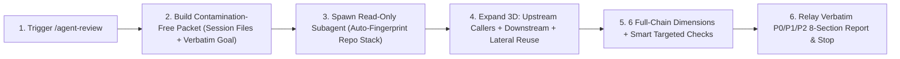

# agent-review (全链路独立代码审查与影响面分析)

English | [简体中文](README.zh-CN.md)

> Independent, read-only full-chain code review and 3D call-graph regression analysis via an isolated subagent: expands beyond `git diff` across upstream callers, downstream dependencies, and lateral shared-component reuse to audit closed loops, single-source-of-truth mappings, `"fix A, break B"` regressions, and omitted companion files—without touching your code.

## The Problem

Conventional AI code reviews tend to stare only at the green and red lines inside `git diff`—and when the same session that wrote the code reviews itself, confirmation bias takes over:
- **Diff tunnel vision**: broken upstream/downstream handoffs, cross-layer schema/mapping drift, and companion files that *should* have been updated together go unnoticed;
- **Missed `"fix A, break B"` regressions**: changes to shared utilities, components, or contracts silently break sibling workflows that were never searched;
- **Unchallenged AI anti-patterns**: `catch` blocks silently returning `[]`, unauthorized fallback defaults masking missing config, symptom-masking band-aids, duplicate wheels, and leftover dead code slip straight through.

`agent-review` delegates the audit to a **fresh, zero-bias, read-only subagent** that fingerprints your repository's real stack and architecture (never force-fitting irrelevant enterprise layers) and delivers a structured 8-section engineering audit.

## Quick Trigger

Run before committing, opening a PR, or modifying shared modules:

- **Review current-session or workspace changes**: `/agent-review` or `"review my changes"`, `"审查一下"`, `"帮我看看这次改动"`
- **Scoped or focused audit**: `/agent-review src/order/ focus on state transitions and authz`, `/agent-review HEAD~2..HEAD`
- **Pre-change impact & caller analysis**: `/agent-review what will changing OrderService.cancel affect?`, `"who calls parseToken"`, `"谁调用了 parseToken"`

## How It Works



### 6 Architecture-Adaptive Review Dimensions

The reviewer subagent first identifies your project's actual shape (layered/DDD backend, SPA/SSR frontend, full-stack monorepo, CLI/SDK library, or script/config repo) and maps universal engineering checks onto the boundaries that actually exist:

1. **End-to-End Closed Loop & Requirement Alignment** — Verifies that the entire execution chain (entrypoint → validation/auth → core logic → persistence/cache/events → response/UI state → tests) is wired end-to-end without missing branches.
2. **Single Source of Truth (SSOT) & Cross-Boundary Mapping** — Checks lossless alignment across storage schemas/entities ↔ domain models ↔ API/RPC/event contracts ↔ client stores/views/CLI outputs (field names, nullability, types, units, enums, defaults).
3. **Domain Boundaries, Layering, Authz & State Transitions** — Audits clean layer separation, authentication & row/tenant isolation, injection surfaces, state-machine transition guards, idempotency, and concurrency safety.
4. **Failure Semantics & Anti-Silent-Fallback** — Ensures consistent rollback/error states and flags AI-typical masked failures (`catch` returning `[]`/fake success, unauthorized business defaults hiding missing config, mock data rendered on API error, relaxed auth guards) while respecting legitimate framework defaults.
5. **Hygiene, Conventions & Anti-Band-Aid** — Catches symptom-level temporary hacks, duplicate implementations bypassing unified project components/protocols, and leftover dead code or legacy compatibility shims.
6. **Active 3D Regression Hunt (`"Fix A, Break B"`) & Test Coverage** — Searches every caller, consumer, and lateral reuse site to verify sibling flows remain intact and critical branches have real test assertions.

### Standard 8-Section Engineering Report

Every change review delivers 8 structured, high-signal sections (suppressing trivial formatting nitpicks and isolating unproven guesses from confirmed defects):

1. **Review Verdict** — `Pass` / `Pass with Risks` / `Changes Requested` plus executive summary.
2. **Prioritized Findings (`P0 / P1 / P2`)** — Confirmed, evidence-backed defects only, with clickable file + line links, trigger path, impact, proof, and fix direction.
3. **Regression Risks & Affected Flows** — Concrete results from the 3D caller/shared-component hunt (`"fix A, break B"` analysis).
4. **Blast Radius / Impact Surface** — Affected modules, layers, contracts/schemas/events, and shared assets.
5. **Modified Files** — Audited added/modified/deleted files and their roles.
6. **Related Unmodified Files** — Split into **Suspected Omissions** (untouched companion files that appear to need synchronized updates) and **Inspected & Compatible Peers**.
7. **Verification Path** — **Executed Read-Only Checks** vs. **Recommended End-to-End Verification Steps**.
8. **Open Items** — `[Hypothesis]` suspicions, `Not verified` blind spots, and open domain/tech-debt questions.

## Installation

### Option 1: Install via `npx skills`

```bash
npx skills add lastxuanain/ainward-skills
```

### Option 2: Git Clone + Symlink

```bash
git clone https://github.com/lastxuanain/ainward-skills.git ~/ainward-skills

# Antigravity
mkdir -p ~/.gemini/config/skills
ln -s ~/ainward-skills/skills/agent-review ~/.gemini/config/skills/agent-review

# Claude Code
mkdir -p ~/.claude/skills
ln -s ~/ainward-skills/skills/agent-review ~/.claude/skills/agent-review

# Codex
mkdir -p ~/.codex/skills
ln -s ~/ainward-skills/skills/agent-review ~/.codex/skills/agent-review

# Cursor
mkdir -p ~/.cursor/skills
ln -s ~/ainward-skills/skills/agent-review ~/.cursor/skills/agent-review
```
