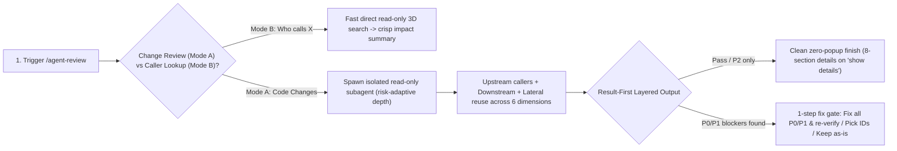

# agent-review (Independent Full-Chain Code Review & Impact Analysis)

English | [简体中文](README.zh-CN.md)

> Independent, read-only full-chain code review and 3D call-graph regression analysis: keeps strict internal rigor across upstream callers, downstream dependencies, and lateral shared-component reuse (`"fix A, break B"`) while presenting **developer-friendly `Result-First` findings by default**—3-line clean exits on `Pass`, clickable `file#L` anchors and plain-language risk explanations when defects exist, a conditional 1-click `P0/P1` fix loop, and fast direct `Mode B` caller lookups.

## The Problem

Conventional AI code reviews tend to hit one of two bad extremes—shallow `"looks good to me"` self-reviews on `git diff`, or bloated 8-section audit walls even when nothing is wrong:

- **Diff tunnel vision & `"fix A, break B"`**: broken cross-layer mappings, silent `catch` fallbacks returning `[]`, omitted companion files, and broken sibling callers go unseen;
- **Wall-of-text fatigue**: printing empty severity sections and long lists of compatible files even on a clean `Pass`, buried under heavy architectural jargon;
- **Dead-end reports & slow trivial lookups**: forcing you to re-type fix commands when `P0/P1` blockers appear, or spinning up a full subagent just to answer `"who calls X?"`.

`agent-review` keeps **deep engineering rigor on the inside** and **crisp, actionable clarity on the outside**.

## Quick Trigger

Run before committing, opening a PR, or changing shared code:

- **Review current-session or workspace changes**: `/agent-review` or `"review my changes"`, `"审查一下"`, `"帮我看看这次改动"`
- **Focused scope or full 8-section report**: `/agent-review src/order/ focus on authz`, `/agent-review --full`
- **Fast pre-change caller/impact lookup**: `/agent-review what will changing OrderService.cancel affect?`, `"who calls parseToken"`, `"谁调用了 parseToken"`

## How It Works



### Internal Rigor, Plain-Language Delivery

For code changes (`Mode A`), the isolated subagent fingerprints your stack (never force-fitting non-existent layers) and scales depth by what changed (skipping irrelevant heavy checks on pure docs/styles while running full 3D checks on logic, API, data, and shared helpers):

1. **End-to-End Closed Loop & Requirement Alignment** — checks the full execution flow without broken handoffs or missing branches.
2. **Cross-Boundary Contract Consistency** — verifies field names, types, nullability, enums, units, and defaults across storage, domain, APIs, and UI/CLI.
3. **Boundaries, Authz & State Safety** — audits layer separation, auth/row/tenant isolation, injection surfaces, state guards, and concurrency.
4. **Failure Semantics & Anti-Silent-Fallback** — flags masked failures (`catch` returning `[]`/fake success, unauthorized business defaults, mock data on API error) while respecting legitimate defaults.
5. **Hygiene & Anti-Band-Aid** — catches symptom hacks, duplicate wheels bypassing shared utilities, and leftover dead code.
6. **3D Regression Hunt (`"Fix A, Break B"`) & Test Coverage** — traces upstream callers, downstream side effects, and lateral shared peers to verify sibling workflows stay intact.

### Standalone `Result-First` & Conditional Fix Loop

- **3-line `Pass` with zero popups**: when zero issues exist, prints a crisp 3-line verdict + check status and stops cleanly.
- **Confirmed defects first, noise hidden**: lists confirmed `P0/P1/P2` bugs in plain developer language with clickable short `file#L` anchors, concrete breakage triggers, and fix directions. Full 8-section inventories (`Modified Files`, `Inspected & Compatible Peers`, `Blast Radius`, etc.) stay silently cached—reply `"show details"` (`"展开细节"`) anytime to inspect them.
- **1-click `P0/P1` closure**: when `P0` or `P1` blockers appear in standalone mode, opens one action card to **fix all `P0/P1` issues and re-verify** (or pick IDs / skip).
- **Chained caller isolation (`code-sync`)**: supports `Target Workspace`, `Locked Change Scope`, and `Result-First (Chained)` output for clean embedding inside [`code-sync`](../code-sync/README.md).

## Installation

### Option 1: Install via `npx skills`

```bash
npx skills add lastxuanain/ainward-skills
```

### Option 2: Git Clone + Symlink

```bash
git clone https://github.com/lastxuanain/ainward-skills.git ~/ainward-skills

# Antigravity
mkdir -p ~/.gemini/config/skills
ln -s ~/ainward-skills/skills/agent-review ~/.gemini/config/skills/agent-review

# Claude Code
mkdir -p ~/.claude/skills
ln -s ~/ainward-skills/skills/agent-review ~/.claude/skills/agent-review

# Codex
mkdir -p ~/.codex/skills
ln -s ~/ainward-skills/skills/agent-review ~/.codex/skills/agent-review

# Cursor
mkdir -p ~/.cursor/skills
ln -s ~/ainward-skills/skills/agent-review ~/.cursor/skills/agent-review
```
