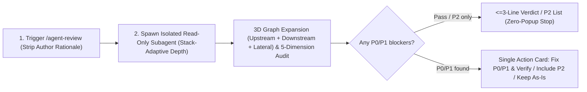

# agent-review (Independent Full-Chain Code Review)

English | [简体中文](README.zh-CN.md)

> **Isolated read-only subagent** code and 3D call-graph regression review: strips away implementer confirmation bias, traces upstream callers, downstream side effects, and lateral shared peers (`"fix A, break B"` + omitted companion files), exits in **at most 3 crisp lines on `Pass`**, and provides clickable `[file.ts](file:///...#L...)` evidence plus a 1-click fix gate when `P0`/`P1` blockers appear.

## The Problem

- **Confirmation bias & diff tunnel vision**: Self-reviewing `git diff` in the authoring session misses cross-layer field drift, silent `catch` fallbacks returning `[]`, and broken sibling callers reusing shared helpers;
- **Audit-wall fatigue**: Printing bloated multi-section compatible-file inventories and methodology jargon even when zero defects exist;
- **Dead-end blocker reports**: Listing `P0`/`P1` bugs without a clean 1-step path to fix and verify them.

## Quick Trigger

Run before committing, opening a PR, or shipping non-trivial changes:

- `/agent-review` or natural language: `"agent review"`, `"code review"`, `"independent review"`, `"review my changes"`, `"审查一下"`, `"独立审查"`, `"代码审查"`
- Scoped review: `/agent-review src/order/ focus on authz and state guards`, `/agent-review HEAD~1`

## How It Works



- **Contamination-free 3D audit**: Passes only objective scope and verbatim user requirements to the subagent; checks end-to-end closed loops, cross-boundary contracts, authz/concurrency guards, and AI silent-fallback traps across callers, callees, and shared peers (scaling down automatically for pure docs/CSS edits).
- **High-signal delivery**: Clean `Pass` finishes in at most 3 lines with zero popups; confirmed `P0/P1/P2` defects include clickable `[file.ts](file:///...#L...)` links, concrete failure triggers, and fix directions while separating `[推测]` suspicions and unrun checks honestly.
- **Proportional fix closure**: Opens a single fix card only when `P0`/`P1` blockers exist; verifies localized fixes via fast targeted checks and re-dispatches the subagent only for multi-file or architectural changes.

## Installation

Install via `npx skills add lastxuanain/ainward-skills`, or clone the repo and run [`../../scripts/link.sh`](../../scripts/link.sh):

```bash
./scripts/link.sh
```
