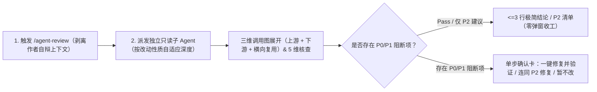

# agent-review（全链路独立代码审查）

[English](README.md) | 简体中文

> 基于**独立只读子 Agent** 的全链路代码与三维调用图回归审查工作流：剥离写代码会话的确认偏见，沿上游调用方、下游副作用与横向公共复用排查「修 A 坏 B」与疑似漏改文件；无问题 **最多 3 行极简收工**，发现 `P0/P1` 阻断项带可点击 `[file.ts](file:///...#L...)` 证据直指要害并提供一键修复闭环。

## 解决什么问题

- **自己审自己 + 只看局部 `git diff`**：顺着刚写完代码的思维惯性放行跨层字段漂移、`catch` 静默吞错返空，以及改公共组件带坏兄弟业务的「修 A 坏 B」回归；
- **无论有无问题都刷八股长文**：哪怕一切正常 `Pass`，也打印大段兼容文件清单与方法论黑话；
- **审出阻断项后干停**：列出缺陷却缺少顺滑的一键修复闭环。

## 快速触发

在提交代码、发起 PR 前或完成复杂改动后输入：

- `/agent-review` 或自然语言：`审查一下`、`独立审查`、`代码审查`、`agent review`、`code review`、`independent review`、`review my changes`
- 指定范围或关注点：`/agent-review src/order/ 重点看状态流转与权限边界`、`/agent-review HEAD~1`

## 工作方式



- **零污染隔离与三维穿透**：仅向子 Agent 传递客观改动范围与原始需求原文；沿**上游入口、下游存储/接口、横向共享组件**核查全链路闭环、跨层契约一致、权限并发安全与反静默吞错（纯文档/样式微调自动裁剪重型维度）。
- **极简高信噪比输出**：`Pass` 最多 3 行零弹窗收工；确证缺陷按 `P0/P1/P2` 附可点击 `[file.ts](file:///...#L...)` 锚点说明触发路径与修法，未证实怀疑严格归入 `[推测]` 盲区，绝不虚报测试通过。
- **按需闭环修复**：仅在出现 `P0/P1` 阻断项时提供单步修复卡；局部小修直接靶向验证，仅跨文件/架构级修复才复派子 Agent 复审。

## 安装

使用 `npx skills add lastxuanain/ainward-skills`，或克隆仓库后运行根目录一键软链接脚本 [`../../scripts/link.sh`](../../scripts/link.sh)：

```bash
./scripts/link.sh
```
