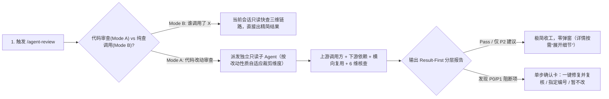

# agent-review（全链路独立代码审查与影响面分析）

[English](README.md) | 简体中文

> 基于独立子 Agent 的只读全链路代码审查与三维调用链影响面分析工作流：底层坚持严谨的上游/下游/横向复用排查（防“自己审自己”偏见与“修 A 坏 B”回归），对外默认采用**普通开发者友好的 `Result-First`（内严外浅）呈报**——无问题 3 行收工、有问题带可点击行号锚点直出人话风险点、发现 `P0/P1` 自动提供一键修复闭环，完整 8 板块详表按需“展开细节”随时调出。

## 解决什么问题

普通 AI 代码审查常卡在两个极端——要么“自己审自己”只看几行 `git diff` 敷衍放行，要么每跑一次就甩出八股文般的 8 板块文字墙：

- **只见局部不见链路**：漏看上下游断链、跨层字段漂移、静默吞错返空，以及改了公共函数却带坏其他业务的“修 A 坏 B”回归；
- **独立报告太重、没问题也刷两屏**：哪怕一切正常 `Pass`，也要看一堆“已核查兼容文件”“实际改动文件清单”和生硬方法论黑话；
- **发现问题后干停**：列出一堆缺陷却得自己重新打字让它修；纯查一句“谁调用了 X”也要干等子 Agent 拉起半天。

`agent-review` 做到**内部查得狠、外部说人话、无事零弹窗、有阻断一键修**。

## 快速触发

在提交代码、发起 PR 前或评估改动波及面时直接输入：

- **审查本轮对话或工作区变更**：`/agent-review` 或「审查一下」「帮我看看这次改动」
- **指定范围或完整 8 板块报告**：`/agent-review src/order/ 重点看状态流转与权限边界`、`/agent-review --full`
- **改前调用链与影响面速查（直接秒回）**：`/agent-review OrderService.cancel 改动会影响什么`、「谁调用了 `parseToken`」

## 工作方式



### 内严外浅：底层 6 维全链路审查 + 外部人话呈报

子 Agent 会先识别仓库真实技术栈（不强套不存在的架构分层），**并根据改动性质自适应裁剪**（纯文档/样式微调跳过无关重型维度；逻辑/接口/公共模块改动走全套三维排查），重点盯防：

1. **全链路闭环与需求对齐** — 入口触发、校验鉴权、核心逻辑、持久化/副作用到结果反馈是否完整闭合。
2. **跨层契约一致性** — 存储、后端模型、接口返回与前端展示之间的字段名、类型、空值、枚举与默认值是否对齐。
3. **边界、权限与并发状态** — 越权/租户隔离、注入风险、状态跃迁守卫与幂等并发是否可靠。
4. **异常语义与反静默吞错** — 严查 `catch` 返空数组/`null` 伪装成功、无依据默认值兜底掩盖缺配置或报错渲染假数据。
5. **工程整洁度与规约统一** — 揪出头痛医头的临时补丁、绕开项目统一组件重复造轮子、废弃死代码与兼容残留。
6. **“修 A 坏 B”三维回归与测试缺口** — 沿上游调用方、下游依赖、横向公共组件核查是否带坏兄弟流程，以及关键分支是否真测过。

### 默认 `Result-First` 分层体验（支持按需展开与一键修复）

- **`Pass` 零废话**：没有确认问题时，只输出 3 行核心结论与验证状态，**零弹窗收工**。
- **有问题直指要害**：只列经代码实证的 `P0/P1/P2` 问题，用大白话说明“**改坏了什么场景、怎么修**”并附可点击的**短文件+行号锚点**；其余“实际改动清单”“已核查兼容文件”等详表静默保留在上下文中，回复 **`展开细节`** 即可随时调出完整 8 板块。
- **`P0/P1` 单步闭环**：审出阻断级问题时，文末紧跟 1 张确认卡，支持鼠标一点**「一键修复全部 P0/P1 并复核」**。
- **串联隔离模式（供 [`code-sync`](../code-sync/README.zh-CN.md) 等调用）**：支持传入 `Target Workspace`（目标 worktree 路径）与 `Locked Change Scope`（仅审本次同步改动，严防并行任务串线），并以极简无行号摘要嵌入上游统一报告。

## 安装

### 方式一：使用 `npx skills`

```bash
npx skills add lastxuanain/ainward-skills
```

### 方式二：Git 克隆 + 软链接

```bash
git clone https://github.com/lastxuanain/ainward-skills.git ~/ainward-skills

# Antigravity
mkdir -p ~/.gemini/config/skills
ln -s ~/ainward-skills/skills/agent-review ~/.gemini/config/skills/agent-review

# Claude Code
mkdir -p ~/.claude/skills
ln -s ~/ainward-skills/skills/agent-review ~/.claude/skills/agent-review

# Codex
mkdir -p ~/.codex/skills
ln -s ~/ainward-skills/skills/agent-review ~/.codex/skills/agent-review

# Cursor
mkdir -p ~/.cursor/skills
ln -s ~/ainward-skills/skills/agent-review ~/.cursor/skills/agent-review
```
