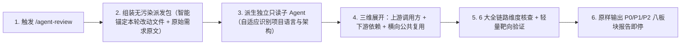

# agent-review（全链路独立代码审查与影响面分析）

[English](README.md) | 简体中文

> 基于独立子 Agent 的只读全链路代码审查与三维调用链影响面分析工作流：跳出局部 `git diff`，沿上游调用方、下游依赖与横向复用组件展开，核查全链路闭环、单一事实源跨层映射、架构边界、“修 A 坏 B”回归风险与关联漏改文件，只报证据不改代码。

## 解决什么问题

普通 AI 代码审查往往只盯着 `git diff` 里的几行红绿改动，且如果让刚写完代码的同一个会话“自己审自己”，极易陷入确认偏见：
- **只见局部不见链路**：漏看上下游衔接断链、跨层字段/类型映射失真，以及本应同步修改却漏改的关联文件；
- **漏查“修 A 坏 B”回归**：改了公共组件、基础工具或共享协议，却没检索其他业务调用方是否被连带破坏；
- **放过隐蔽工程坏味道**：对 `catch` 静默吞错返空、无依据默认值兜底、头痛医头的临时补丁、重复造轮子与残留死代码视而不见。

`agent-review` 将任务派发给**零历史包袱的独立只读子 Agent**，自动识别当前项目的语言与真实架构形态（不生搬硬套不存在的分层），展开三维全链路复核并输出结构化的 8 板块工程审计报告。

## 快速触发

安装后，在提交代码、发起 PR 前或评估改动波及面时直接输入：

- **审查本轮对话或工作区变更**：`/agent-review` 或「审查一下」「帮我看看这次改动」
- **指定范围或侧重点**：`/agent-review src/order/ 重点看状态流转与权限边界`、`/agent-review HEAD~2..HEAD`
- **改前调用链与影响面分析**：`/agent-review OrderService.cancel 改动会影响什么`、「谁调用了 `parseToken`」

## 工作方式



### 6 大全链路审查内核（跨语言/跨架构自适应）

审查子 Agent 会先识别仓库实际形态（后端微服务/DDD、前端应用、全栈工程、CLI/SDK 基础库或脚本配置仓），将统一工程原则映射到项目真实边界：

1. **全链路闭环与需求对齐** — 从入口触发、参数校验/鉴权、核心逻辑、持久化/缓存/事件副作用到响应反馈与测试是否完整闭环，有无断链或偏离需求。
2. **单一事实源（SSOT）与跨边界映射一致性** — 核查存储模型/Schema ↔ 内部领域模型 ↔ 接口契约（DTO/Proto/GraphQL/JSON）↔ 前端状态/CLI 输出之间的字段、类型、可空性、枚举、精度与默认值是否严丝合缝。
3. **业务边界、分层、权限安全与状态流转** — 职责分层是否清晰，鉴权、行级/租户隔离与防注入是否严密，状态机跃迁守卫、幂等与并发控制是否健全。
4. **失败语义与反静默吞错兜底** — 异常时状态是否回滚一致；严查 `catch` 返空伪装成功、无业务依据填充默认值掩盖缺配置、接口报错渲染假数据及擅自放宽鉴权（区分框架合法默认值防误报）。
5. **反临时补丁、重复实现、历史包袱与规约统一** — 揪出掩盖症状的临时硬编码补丁、无视项目既有公共组件/协议的重复造轮子，以及重构遗留的废弃死代码与双轨兼容包袱。
6. **“修 A 坏 B”三维回归排查与测试缺口** — 主动检索全部调用方、消费方与公共复用场景，确认改动是否波及其他业务流，以及关键分支与异常路径是否有真实测试覆盖。

### 标准 8 板块输出报告

每次代码变更审查固定输出以下 8 个高信噪比板块（无确证问题时如实写 `无`，绝不拿主观格式挑刺凑数，推测项严格归入遗留项）：

1. **审查结论** — `Pass` / `Pass with Risks` / `Changes Requested` 及核心判断。
2. **问题分级清单（`P0 / P1 / P2`）** — 仅列有代码证据的确证问题（含文件行号、触发链路、业务影响、代码依据与修复方向）。
3. **回归风险与受影响业务** — 沿三维调用链排查“修 A 坏 B”的具体结论与波及业务流。
4. **影响面** — 涉及的模块、分层、接口/协议/事件/表结构及公共组件范围。
5. **实际改动文件** — 本次审查覆盖的新增/修改/删除文件及职责定位。
6. **关联未改文件** — 拆分为**「疑似漏改文件预警（按契约本应同步改却未改）」**与**「已核查兼容的上下游关联文件」**。
7. **验证路径** — 区分**「已实跑的只读验证证据」**与**「建议的端到端验证步骤/命令」**。
8. **遗留项** — 收拢证据尚不充分的 `[推测]` 项、`Not verified` 静态盲区与待确认业务问题。

## 安装

### 方式一：使用 `npx skills`

```bash
npx skills add lastxuanain/ainward-skills
```

### 方式二：Git 克隆 + 软链接

```bash
git clone https://github.com/lastxuanain/ainward-skills.git ~/ainward-skills

# Antigravity
mkdir -p ~/.gemini/config/skills
ln -s ~/ainward-skills/skills/agent-review ~/.gemini/config/skills/agent-review

# Claude Code
mkdir -p ~/.claude/skills
ln -s ~/ainward-skills/skills/agent-review ~/.claude/skills/agent-review

# Codex
mkdir -p ~/.codex/skills
ln -s ~/ainward-skills/skills/agent-review ~/.codex/skills/agent-review

# Cursor
mkdir -p ~/.cursor/skills
ln -s ~/ainward-skills/skills/agent-review ~/.cursor/skills/agent-review
```
