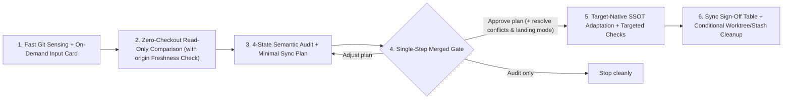

# code-sync (语义化代码同步与跨分支合并)

English | [简体中文](README.zh-CN.md)

> Interactive, intent-driven cross-branch code synchronization and semantic porting: anchors source branch, target branch, and sync scope, extracts the true engineering intent behind your changes without switching branches, audits the target branch across four semantic states (*Already Synced*, *Superseded by Refactor*, *Missing/Regressed*, *Semantic Conflict*) instead of blind `cherry-pick` or copy-paste, gates on a **Minimal Sync Plan (`最小改动清单`)**, re-adapts idiomatically to the target's current architecture & SSOT, and closes with targeted verification and a **Sync Sign-Off Table (`同步核销回执表`)**.

## The Problem

When porting hotfixes, features, or in-progress edits from one branch or workspace to a diverged target branch (like `main`), raw Git commands and naive AI prompts routinely fail in three ways:

- **Blind `cherry-pick` & legacy copy-pasting**: When the target branch has refactored directories, split modules, or migrated its Single Source of Truth (SSOT), replaying old hunks either triggers messy conflicts or reintroduces obsolete abstractions into the new architecture;
- **Clean diff, broken semantics**: A patch can apply without syntax conflicts while breaking newly added state guards, side effects, error envelopes, or shared callers on the target branch;
- **Clobbered working trees**: Running `git checkout` or unprompted `stash` / `commit` while you still have uncommitted edits on your source branch disrupts your active workspace.

`code-sync` turns cross-branch merging into a **human-gated semantic adaptation workflow**—and pairs naturally with [`agent-review`](../agent-review/README.md) (for an isolated 3D regression audit afterward) and [`work-report`](../work-report/README.md) (for a paced walkthrough).

## Quick Trigger

Invoke the skill in chat whenever you need to sync or port changes to another branch:

- **Interactive launch (auto-detects context & prompts only for missing inputs)**: `/code-sync`, `"code sync"`, `"sync to branch"`, `"semantic merge"`, `"代码同步"`, `"代码合并"`
- **Parameterized launch (adopts stated inputs automatically; skips Gate 1 when complete)**:
  - `/code-sync sync changes from this conversation to main`
  - `/code-sync port uncommitted workspace changes to release/v2`
  - `/code-sync from fix/order-timeout to main`

## How It Works



### 1. Smart Sensing & On-Demand Three-Input Anchoring (*Source · Target · Scope*)

Starts with a fast, offline read-only Git probe (current branch, dirty files, session-edited files, mounted `git worktree` paths, and cached `origin/*` refs). Only missing or ambiguous parameters are requested in **one combined question card** with smart `(Recommended)` defaults:

- **4 Adaptive Sync Scopes**: ① **Session Changes** (inherits full conversational fix intent) ② **Workspace Uncommitted Changes** (flags unrelated dirty files rather than blindly bundling them) ③ **Source Branch Commits (`target..source`)** ④ **Specific Commits / File Paths**.
- **Zero-Blocking Remote Freshness Check**: Never stalls on unprompted `git fetch`, yet compares local `<target>` against cached `origin/<target>`—alerting you and auditing against the newer ref whenever local `<target>` lags behind.

### 2. Zero-Checkout 4-State Semantic Audit

Reads the target branch strictly via `git show / grep / log <target>` (or an existing mounted target worktree) without touching your active branch, tracing moved or refactored modules via `git log --follow` and symbol search to classify every logical change unit:

1. **`Already Synced (已同步)`** — Equivalent logic already exists on target (backed by target file + line citations). Skipped.
2. **`Superseded by Refactor (已被后续重构覆盖)`** — Target redesigned the architecture so the root cause is genuinely eliminated (verified across main flow, state, side effects, and error paths; any residual gap is split out for adaptation).
3. **`Missing or Regressed — Needs Adaptation (仍缺失或存在回归)`** — Added to the **Minimal Sync Plan**, re-adapted idiomatically to the target branch's **current architecture, shared components, and SSOT** while preserving **main flow, data state, side effects, error handling, and 3D call-chain safety**.
4. **`Semantic Conflict / Product Divergence (存在语义冲突或业务分歧)`** — Target intentionally changed contracts or business rules; clear options with trade-offs are surfaced for your decision rather than guessed.

### 3. Single-Step Merged Gate & Safe Isolated Landing

- **One Gate, Zero Popup Chains**: After presenting the 4-State Audit Table and Minimal Sync Plan, plan approval, conflict choices (if any), and cross-branch landing mode (defaulting to an **isolated temporary `git worktree`** when your source workspace is dirty, or `git stash` + branch switch) are merged into **one** confirmation turn.
- **Targeted Verification & Conditional Cleanup**: Runs fast checks on the target workspace (marking unrun checks honestly as `Not verified`), outputs a **Sync Sign-Off Table (`同步核销回执表`)**, and **never runs `git commit` or `git push` automatically**. Stops cleanly on normal landings; opens a cleanup choice **only** when a temporary `worktree` or `git stash` was created so you can either inspect uncommitted changes or commit on target and auto-clean/restore your source workspace.

## Installation

### Option 1: Install via `npx skills`

```bash
npx skills add lastxuanain/ainward-skills
```

### Option 2: Git Clone + Symlink

```bash
git clone https://github.com/lastxuanain/ainward-skills.git ~/ainward-skills

# Antigravity
mkdir -p ~/.gemini/config/skills
ln -s ~/ainward-skills/skills/code-sync ~/.gemini/config/skills/code-sync

# Claude Code
mkdir -p ~/.claude/skills
ln -s ~/ainward-skills/skills/code-sync ~/.claude/skills/code-sync

# Codex
mkdir -p ~/.codex/skills
ln -s ~/ainward-skills/skills/code-sync ~/.codex/skills/code-sync

# Cursor
mkdir -p ~/.cursor/skills
ln -s ~/ainward-skills/skills/code-sync ~/.cursor/skills/code-sync
```
