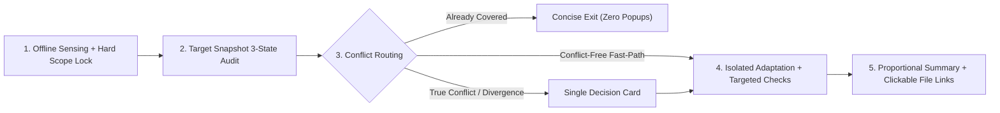

# code-sync (Semantic Cross-Branch Code Porting)

English | [简体中文](README.zh-CN.md)

> Port bug fixes, features, or refactors across branches **by engineering intent rather than blind patch replay**, with **bidirectional parallel-session isolation** and **conflict-free fast-path execution**: locks strictly to your requested scope, audits the target snapshot read-only (auto-aligning lagging `origin/<target>` refs without popup stalls), adapts idiomatically to target architecture, runs targeted checks, and delivers proportional bullets with clickable file-line links (never hijacking plain `git merge / pull / push`).

## Quick Trigger

- **Interactive launch (prompts only for missing inputs)**: `/code-sync`, `"code sync"`, `"sync to branch"`, `"port changes to"`, `"semantic merge"`, `"代码同步"`, `"同步到分支"`, `"把改动同步到"`
- **Parameterized launch (zero popups when inputs are clear and conflict-free)**:
  - `/code-sync port changes from this conversation to main`
  - `/code-sync sync uncommitted workspace edits to release/v2`
  - `/code-sync from fix/order-timeout to main`

## How It Works



- **Strict bidirectional isolation**: Session-scoped syncs extract **only** edits/commits authored in the current conversation (stopping cleanly if zero edits exist instead of scanning `target..source`); target inspection reads only the latest snapshot and direct callers/peers without browsing unrelated parallel commit logs or touching unrelated dirty files.
- **Auto-alignment & safe worktree landing**: Automatically bases on `origin/<target>` when local `<target>` has `0 ahead, K behind` commits; creates an isolated sibling `git worktree` when `<target>` is unmounted so your source workspace stays untouched without unprompted `git stash` (offering 1-click commit + worktree cleanup at completion).
- **Proportional, clickable delivery**: Scales output length to change size with compact clickable `[file.ts](file:///...#L...)` links and honest check outcomes—suggesting [`/agent-review`](../agent-review/README.md) in 1 line only when non-trivial semantic rewrites or skipped temp-worktree checks warrant independent verification.

## Installation

```bash
# Option 1: Install via npx skills
npx skills add lastxuanain/ainward-skills

# Option 2: Clone + symlink via scripts/link.sh (see root README for all flags)
git clone https://github.com/lastxuanain/ainward-skills.git ~/ainward-skills
~/ainward-skills/scripts/link.sh --skills code-sync
```
