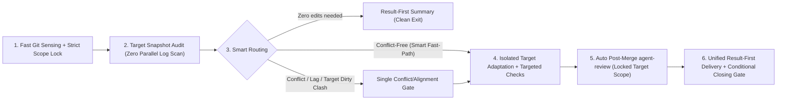

# code-sync (语义化代码同步与跨分支合并)

English | [简体中文](README.zh-CN.md)

> Interactive, intent-driven cross-branch code synchronization and semantic porting with **strict parallel-conversation isolation**, **Smart Fast-Path execution**, **Result-First reporting**, and **automatic post-merge `agent-review`**: locks strictly to your requested scope (e.g., current conversation edits only—ignoring unrelated parallel commits), inspects the target branch snapshot read-only without scanning unrelated commit history, re-adapts idiomatically to target SSOT, runs targeted verification, and automatically chains an isolated Result-First [`agent-review`](../agent-review/README.md) on the merged changes.

## The Problem

When porting hotfixes, features, or in-progress edits from one branch or parallel session onto a busy target branch (like `main`), raw Git commands and naive AI prompts routinely fail in four ways:

- **Blind `cherry-pick` & legacy copy-pasting**: When the target branch has refactored directories or migrated its Single Source of Truth (SSOT), replaying old hunks either triggers messy conflicts or reintroduces obsolete abstractions;
- **Parallel-session scope bleed**: When multiple tasks or conversations run concurrently on the same repo or `main` branch, naive prompts sweep other sessions' commits or unrelated dirty files into analysis and review;
- **Noisy line-number & symbol dumps**: Dumping dozens of `#L` line links, class names, and pre-execution boilerplate tables buries the actual outcome you care about;
- **Clobbered working trees & unreviewed merges**: Running unprompted `git checkout` or `git stash` disrupts parallel work, while landing adapted changes without an independent 3D regression check risks `"fix A, break B"` regressions.

`code-sync` turns cross-branch merging into a **parallel-safe, result-first semantic adaptation + independent review loop**.

## Quick Trigger

Invoke the skill in chat whenever you need to sync or port changes to another branch:

- **Interactive launch (auto-detects context & prompts only for missing inputs)**: `/code-sync`, `"code sync"`, `"sync to branch"`, `"semantic merge"`, `"代码同步"`, `"代码合并"`
- **Parameterized launch (adopts stated inputs automatically; skips Gate 1 when complete)**:
  - `/code-sync sync changes from this conversation to main`
  - `/code-sync port uncommitted workspace changes to release/v2`
  - `/code-sync from fix/order-timeout to main`

## How It Works



### 1. Strict Bidirectional Parallel Isolation

- **Source-side hard lock**: When you ask to sync **Session Changes (`本次对话的改动`)** (or specific commits/files), `code-sync` treats that scope as a strict allowlist—extracting **only** edits and commits authored in the current conversation. Other commits on the branch and unrelated dirty workspace files are silently ignored (and if no edits occurred in the conversation, it prompts cleanly instead of silently scanning branch history).
- **Target-side snapshot isolation**: Reads **only** the current snapshot of target files and direct 3D callers/peers relevant to the synced units—never browsing unrelated parallel commits on `main` unless a direct line-level or contract conflict occurs, and never touching unrelated dirty files on target.

### 2. Smart Fast-Path & Safe Isolated Landing

- **Zero redundant popups when clean**: When parameters are clear, zero semantic/dirty conflicts exist, local `<target>` does not lag `origin/<target>`, and landing is non-destructive, `code-sync` skips the pre-execution checklist gate and runs straight through adaptation, targeted verification, and post-merge review.
- **Pauses only when judgment is needed**: Surfaces a concise plain-language summary and **one** merged gate only when there is a semantic conflict, same-file parallel dirty clash on target, local `<target>` lagging cached `origin/<target>`, or an explicit workspace decision.
- **Non-disruptive landing**: Edits only the synced files when already on `<target>` or a clean mounted `<target>` worktree; automatically creates an isolated sibling `git worktree` when `<target>` is unmounted, never running `git stash` or switching a dirty source branch unprompted.

### 3. Result-First Output & Automatic Post-Merge `agent-review`

- **Outcomes + short filenames first, details on demand**: Hides `#L` line numbers, class/symbol walls, and audit jargon by default—presenting clean functional outcomes alongside **short target filenames** (`synced / skipped / touched files / verified / review verdict`). When checks skip inside a newly created temporary worktree due to missing local dependencies, states why in 1 plain sentence with the exact command to run back on `<target>`. Reply `"show details"` (`"展开细节"`) anytime for clickable line links and full call-chain proof.
- **Seamless `agent-review` handoff**: Whenever target files are modified, `code-sync` automatically invokes [`agent-review`](../agent-review/README.md) with a locked `Target Workspace` path, `Locked Change Scope` (only the synced changes—no source or parallel-task bleed), verbatim requirement context (zero self-justification bias), and `Result-First (Chained)` output profile.
- **Clean closing**: Stops with zero popups when `Pass` and no temporary `worktree`/`stash` was created; otherwise opens a single closing gate (defaulting `(Recommended)` to committing on `<target>` and auto-cleaning the temporary worktree whenever review passes without `P0`/`P1` blockers).

## Installation

### Option 1: Install via `npx skills`

```bash
npx skills add lastxuanain/ainward-skills
```

### Option 2: Git Clone + Symlink

```bash
git clone https://github.com/lastxuanain/ainward-skills.git ~/ainward-skills

# Antigravity
mkdir -p ~/.gemini/config/skills
ln -s ~/ainward-skills/skills/code-sync ~/.gemini/config/skills/code-sync

# Claude Code
mkdir -p ~/.claude/skills
ln -s ~/ainward-skills/skills/code-sync ~/.claude/skills/code-sync

# Codex
mkdir -p ~/.codex/skills
ln -s ~/ainward-skills/skills/code-sync ~/.codex/skills/code-sync

# Cursor
mkdir -p ~/.cursor/skills
ln -s ~/ainward-skills/skills/code-sync ~/.cursor/skills/code-sync
```
