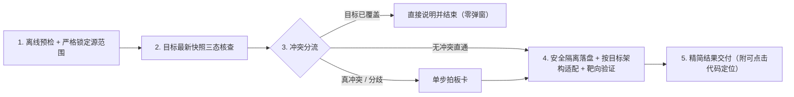

# code-sync（语义化代码同步与跨分支移植）

[English](README.md) | 简体中文

> 按**工程意图而非机械补丁**跨分支移植代码，内置**双向并行对话隔离**与**无冲突直通执行**：严格锁定指定范围（绝不串入同分支其他并行提交），只读目标分支最新快照并自动对齐落后的缓存远端，按目标当前架构重适配、跑靶向验证，并以精炼条目 + 可点击文件行号定位交付结果（日常 `git merge / pull / push` 不误触发）。

## 快速触发

- **交互式启动（仅补全缺失项）**：`/code-sync` 或 `"代码同步"`、`"同步到分支"`、`"把改动同步到"`、`"code sync"`、`"semantic merge"`
- **带参直通（参数齐全且无冲突时零弹窗直奔结果）**：
  - `/code-sync 把本轮对话的改动同步到 main`
  - `/code-sync 将当前工作区改动同步到 release/v2`
  - `/code-sync 从 fix/order-timeout 同步到 main`

## 工作方式



- **双向并行硬隔离**：同步“本次对话的改动”时仅提取本会话真实修改/提交（零编辑时主动提醒确认，绝不静默扫 `target..source` 兜底）；目标端仅读相关文件的最新快照与直接调用方，不泛扫并行提交历史，不碰无关脏文件。
- **自动对齐与安全载体**：本地目标分支单纯落后 `origin/<target>`（`0 ahead, K behind`）时自动基于最新远端快照推进，不弹窗打断；源分支开发现场未挂载目标分支时，自动建兄弟临时 `git worktree` 落盘而不擅自 `git stash`（完工后支持一键在目标分支 `commit` 并移除临时目录）。
- **精炼透明交付**：随改动规模自适应输出篇幅，附可点击短文件行号链接与真实测试状态（临时目录缺依赖跳测时如实说明并给出复跑命令；涉及复杂语义重写时提示可按需运行 [`/agent-review`](../agent-review/README.zh-CN.md)）。

## 安装

```bash
# 方式一：通过 npx skills 安装整套技能
npx skills add lastxuanain/ainward-skills

# 方式二：克隆仓库后通过 link.sh 软链接本技能（详见根目录 README）
git clone https://github.com/lastxuanain/ainward-skills.git ~/ainward-skills
~/ainward-skills/scripts/link.sh --skills code-sync
```
