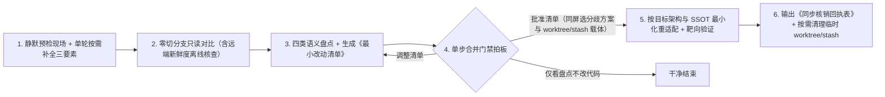

# code-sync（语义化代码同步与跨分支合并）

[English](README.md) | 简体中文

> 交互式、语义驱动的跨分支代码同步与移植工作流：先智能锚定「源分支、目标分支、合并范围」，零切分支提取源改动的真实修复语义与业务意图，对照目标分支最新架构做四类状态盘点（已同步 / 已被重构覆盖 / 缺失或回归 / 语义冲突），拒绝无脑 `cherry-pick` 与机械复制，经《最小改动清单》门禁确认后按目标架构最小化重适配，并通过靶向验证与《同步核销回执表》闭环。

## 解决什么问题

在日常研发（如线上热修同步回已重构的 `main`、同一会话刚改好的逻辑同步到另一分支、或多分支并行演进）中，直接让 AI 合并代码往往会踩中三大坑：

- **无脑 `cherry-pick` 或机械复制旧代码**：目标分支早已做过目录重构、组件拆分或事实源（SSOT）迁移，AI 强行照搬源分支代码，要么冲突一团糟，要么把旧结构重新塞回新架构；
- **“语法无冲突，语义已翻车”**：有些改动物理上能合并进去，但忽略了目标分支新增的状态流转、副作用、异常处理或公共复用调用方，埋下隐蔽回归；
- **乱切分支破坏未提交现场**：你人还在源分支且手头有未提交改动，AI 一上来就 `git checkout` 或擅自 `stash / commit`，打乱当前开发现场。

`code-sync` 将跨分支合并升级为**「先提取真实意图 → 零切分支四象限盘点 → 最小改动清单拍板 → 按目标架构安全重适配」**的可控工程闭环（落地后还可无缝衔接 [`agent-review`](../agent-review/README.zh-CN.md) 独立审查或 [`work-report`](../work-report/README.zh-CN.md) 逐项汇报）。

## 快速触发

安装后，在需要跨分支同步/移植代码的对话中直接输入：

- **交互式启动（自动探测现场并补全参数）**：`/code-sync` 或「代码同步」「代码合并」「同步到分支」「合并到分支」
- **直接带参启动（已知参数自动采纳，全齐则免弹窗直进分析）**：
  - `/code-sync 把本次对话的改动同步到 main`
  - `/code-sync 将当前工作区改动合并到 release/v2`
  - `/code-sync 从 fix/order-timeout 同步到 main`

## 工作方式



### 1. 智能预检与三要素单轮锚定（源分支 · 目标分支 · 合并范围）

启动后先做零阻塞本地 Git 探测（当前分支、工作区脏状态、会话修改记录、已有 `git worktree` 及本地缓存的 `origin/*` 引用），仅对口令中**未指明或有歧义**的项在**同一张问题卡**中带智能推荐值一次问清：

- **4 类合并范围自适应推荐**：① **本次对话的改动**（直接继承会话修复背景） ② **当前工作区未提交改动**（自动识别并隔离无关脏文件） ③ **源分支领先提交（`target..source`）** ④ **指定 Commit / 文件路径**。
- **远端新鲜度零阻塞核查**：默认不联网卡顿 `git fetch`，但会自动对比本地 `<target>` 与缓存的 `origin/<target>`；若本地分支落后则主动预警并基于更新的引用盘点。

### 2. 零切分支四类语义状态盘点

分析全程通过 `git show / grep / log <target>`（或本地已挂载的目标 `worktree`）只读探查，绝不动当前工作区；遇到目标分支文件迁移或拆分时自动追踪重构归宿，将每个逻辑变更单元精准归入四类：

1. **已同步（`Already Synced`）** — 目标分支已有等价修复或实现（附目标分支文件与行号证据），直接跳过。
2. **已被后续重构覆盖（`Superseded by Refactor`）** — 目标分支已通过新架构消除根因（逐一核验主链路、状态、副作用与异常边界确已覆盖后跳过；若新架构下仍有残余漏洞则单独剥离出来适配）。
3. **仍缺失或存在回归（`Missing or Regressed`）** — 列入《最小改动清单》，以目标分支**当前架构、公共组件与单一事实源（SSOT）**为准重新设计最小改动，确保**主链路、数据状态、副作用、异常处理与目标分支三维调用链**一致。
4. **存在语义冲突或业务分歧（`Semantic Conflict`）** — 目标分支主动改过业务规则或接口契约，整理清晰选项交由门禁拍板，绝不擅自盲猜。

### 3. 单步合并门禁与安全隔离落地

- **一次拍板，拒绝连环弹窗**：在输出《四类状态对照盘点表》与《最小改动清单》后，将**「批准执行清单 + 拍板语义分歧项（如有）+ 选择跨分支落地载体（如当前在源分支且有未提交改动，默认推荐新建独立临时 `git worktree` 保源现场不动，或选 `git stash` 后切分支）」**合并在同一轮门禁完成。
- **靶向验证与按需收尾**：改完目标分支后执行轻量靶向验证（未跑项坦诚标为 `Not verified`），输出《同步核销回执表》，**绝不擅自 `git commit / push`**；常规场景直接干净收手，仅当本次新建了临时 `worktree` 或暂存了源分支 `stash` 时，才提供「保留现场检视」或「提交目标分支改动并自动清理临时 worktree / 切回源分支恢复 stash」的收尾选项。

## 安装

### 方式一：使用 `npx skills`

```bash
npx skills add lastxuanain/ainward-skills
```

### 方式二：Git 克隆 + 软链接

```bash
git clone https://github.com/lastxuanain/ainward-skills.git ~/ainward-skills

# Antigravity
mkdir -p ~/.gemini/config/skills
ln -s ~/ainward-skills/skills/code-sync ~/.gemini/config/skills/code-sync

# Claude Code
mkdir -p ~/.claude/skills
ln -s ~/ainward-skills/skills/code-sync ~/.claude/skills/code-sync

# Codex
mkdir -p ~/.codex/skills
ln -s ~/ainward-skills/skills/code-sync ~/.codex/skills/code-sync

# Cursor
mkdir -p ~/.cursor/skills
ln -s ~/ainward-skills/skills/code-sync ~/.cursor/skills/code-sync
```
