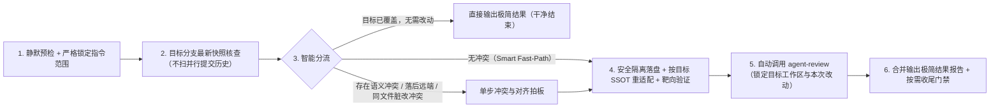

# code-sync（语义化代码同步与跨分支合并）

[English](README.md) | 简体中文

> 交互式、语义驱动的跨分支代码同步与移植工作流：内置**并行开发双向对话隔离**、**无冲突直奔结果（Smart Fast-Path）**、**极简结果导向呈报**与**合并后自动 [`agent-review`](../agent-review/README.zh-CN.md) 独立审查**。严格锁定指令范围（如仅同步本轮对话改动，绝不掺入同分支其他提交），只读目标分支最新快照而不泛扫并行提交，按目标分支架构与 SSOT 重适配并靶向验证，落地后自动隔离复审并合并交付清晰结论。

## 解决什么问题

在多任务并行开发（例如多个对话同时推进、各自往 `main` 合并，或同分支先后有多个任务提交）下，直接让 AI 合并代码常踩中四大痛点：

- **无脑 `cherry-pick` 与机械复制旧代码**：目标分支早已做过目录重构或单一事实源（SSOT）迁移，硬搬旧补丁要么满屏冲突，要么把旧结构塞回新架构；
- **范围不守规矩、并行提交串线**：要求“把本轮对话改动合并到某分支”时，AI 顺手去分析同分支其他对话的提交、或扫描目标分支上其他并行任务的提交记录；
- **满屏代码行号与类名噪音**：汇报里充斥大量 `#L` 行号、类名与长篇五维技术分析，掩盖了最核心的同步与验证结果；
- **破坏并行现场与缺少合后把关**：擅自切分支或 `git stash` 打断手头工作，且按目标架构重适配后缺少独立三维回归审查。

`code-sync` 将跨分支合并升级为**「双向隔离锁定 → 无冲突直通重适配 → 靶向验证 → 自动独立审查 → 极简结果直出」**的安全闭环。

## 快速触发

安装后，在需要跨分支同步/移植代码的对话中直接输入：

- **交互式启动（自动探测现场并仅补全缺失项）**：`/code-sync` 或「代码同步」「代码合并」「同步到分支」「合并到分支」
- **直接带参启动（已知参数自动采纳，全齐则跳过参数询问直进同步）**：
  - `/code-sync 把本轮对话涉及变更的代码合并到 main`
  - `/code-sync 将当前工作区改动合并到 release/v2`
  - `/code-sync 从 fix/order-timeout 同步到 main`

## 工作方式



### 1. 双向并行隔离，严格遵循指令范围

- **源端严格硬锁定**：当你指定“本次对话的改动”（或指定 Commit/文件）时，仅提取**当前对话实际创建、修改或提交的精确改动**；同分支上的其他提交与工作区无关脏文件完全静默隔离（若本轮对话尚未修改代码，直接提示确认范围，绝不擅自扫全分支提交兜底）。
- **目标端只读最新快照**：仅读取目标分支相关文件及直接上下游调用链的**当前最新状态**，严禁泛扫目标分支上其他并行任务的提交历史；仅当本轮改动与目标分支发生真实行级/契约冲突或同文件脏改撞车时，才针对该冲突点溯源并提醒拍板，且绝不碰目标工作区中其他任务的未提交文件。

### 2. 无冲突直奔结果（Smart Fast-Path）与安全落盘

- **无冲突零打断**：当参数明确、无语义分歧或同文件脏改冲突、本地目标分支未落后 `origin/<target>` 且可安全落盘时，自动跳过中间“清单审批弹窗”，直通重适配、验证与独立审查，最终一次性交付结果。
- **有事单步拍板**：仅在存在业务分歧、同文件并行修改撞车、本地目标分支落后缓存远端或需手动选载体时，用 3~5 行纯业务语言说清冲突并在**同一张卡片**内完成决策。
- **并行安全载体**：人在目标分支或已有干净目标 `worktree` 时仅改本次涉及文件；人在源分支且目标未挂载时自动新建独立临时 `git worktree` 落盘，绝不擅自 `git stash` 或切换正在开发的源分支。

### 3. 极简结果导向 + 合并后自动 `agent-review`

- **只看结果与涉及文件，细节按需展开**：默认用大白话呈报「同步了什么、跳过了什么、涉及哪些短文件名、验证结果与审查结论」，隐藏 `#L` 代码行号、类名堆砌与技术八股；若因新建临时 worktree 缺依赖跳过单测，会用 1 句人话说明并附回目标分支后可跑的验证命令。需要核对行号细节时回复「展开细节」即可。
- **合并后自动无缝审查**：只要本次实际修改了目标分支代码，自动调用 [`agent-review`](../agent-review/README.zh-CN.md) 独立子 Agent，通过**目标工作区路径 + 锁定本次同步改动范围 + 原始需求原文（禁止传入自评总结）+ 串联精简输出档位**完成三维回归复核并合并呈报结论。
- **零打扰收尾**：审查 `Pass` 且无临时 worktree 时直接干净收工不弹窗；仅在审出 `P0/P1` 风险或新建了临时 worktree 时，在文末合并给出唯一 1 次收尾选择（若审查 `Pass` 且新建了临时 worktree，默认把「在目标分支 commit 并自动清理临时目录」标为推荐首选项）。

## 安装

### 方式一：使用 `npx skills`

```bash
npx skills add lastxuanain/ainward-skills
```

### 方式二：Git 克隆 + 软链接

```bash
git clone https://github.com/lastxuanain/ainward-skills.git ~/ainward-skills

# Antigravity
mkdir -p ~/.gemini/config/skills
ln -s ~/ainward-skills/skills/code-sync ~/.gemini/config/skills/code-sync

# Claude Code
mkdir -p ~/.claude/skills
ln -s ~/ainward-skills/skills/code-sync ~/.claude/skills/code-sync

# Codex
mkdir -p ~/.codex/skills
ln -s ~/ainward-skills/skills/code-sync ~/.codex/skills/code-sync

# Cursor
mkdir -p ~/.cursor/skills
ln -s ~/ainward-skills/skills/code-sync ~/.cursor/skills/code-sync
```
