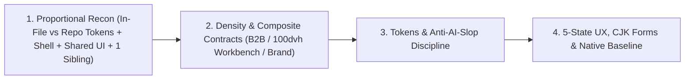

# frontend-craft (Frontend UI Consistency, Visual Craft & UX Guardrails)

English | [简体中文](README.zh-CN.md)

> A self-contained, single-file frontend design and engineering guardrail skill (`v2.0.0`) for AI coding agents. Scales upfront repository reconnaissance to task size, adapts layout density across **B2B admin ledgers, `100dvh` SaaS workbenches, and brand/consumer surfaces**, eliminates unmistakable **"AI-slop" aesthetics**, and enforces **5-state async completeness**, **CJK IME-safe forms**, clean **React / Vue / Svelte state boundaries**, and a modern **native HTML/CSS baseline**—with zero external files or network overhead.

## Trigger & Scope Boundary

- **Automatic**: Applies when creating, redesigning, or refactoring multi-element web UI pages, layouts, tables, forms, modals, or design tokens.
- **Explicit**: `/frontend-craft`, `"frontend craft"`, `"ui spec"`, `"前端规范"`, `"UI 规范"`, `"去 AI 味"`.
- **Strict Non-Goals**: Does **not** trigger on read-only code reviews (`/agent-review`), branch porting (`/code-sync`), pure non-UI TypeScript/state utilities, backend/CLI/infra code, or 1-line localized CSS/copy tweaks (which match surrounding tokens in-file without whole-file rewrites).

## How It Works



### Core Guardrails at a Glance

- **Proportional Parity & Composite Contracts**: Reuses/extends existing `PageShell`, `DataTable` (`—` muted empty cells, right-aligned `tabular-nums` numbers/timestamps, sticky right actions folding `> 3` into `⋯`), `Dialog` (`≤ 5` fields) vs `Drawer` (`> 5` fields/previews), and centralized `StatusBadge` maps; caps single-column forms at `640px–800px`, keeps B2B tables above the fold, and bounds asymmetric CSS Grids with `minmax(0, ...)`.
- **3-Tier Tokens & Anti-AI-Slop**: Enforces `Primitive -> Semantic -> Component` tokens + `@layer` (`90 / 8 / 2` single-neutral ratio); bans purple-pink neon gradients, glowing/nested cards, `> 1` status pill per row, magic hex/px literals, and Emoji UI icons.
- **5-State Async UX & CJK Forms**: Requires `Loading` (skeleton/`keepPreviousData`, no full-screen filter spinners), split `Empty` (`first-use CTA` vs `Clear Filters`), inline `Error` + `Retry` (never `catch -> return []`), `Overflow` (`min-w-0` + `truncate`), and `Pending` locks; enforces blur-delayed validation (`:user-invalid`), React/DOM CJK IME Enter guard (`(e.nativeEvent?.isComposing ?? e.isComposing) || e.keyCode === 229`), dirty-form leave protection, and `<button type="button">` / `<a href>` + `aria-label` semantics.
- **Clean State & Modern Native Baseline**: Enforces one-way `pages -> features -> ui` layers, URL-synced filters/tabs/pagination, synchronous derived state (banning `useEffect` -> `setState` mirrors), imperative `<dialog>` `ref.showModal()`/`close()` (never `<dialog open={isOpen}>`), `@container`, `100dvh`, `:has()`, `field-sizing: content`, `color-mix(in oklab)`, CLS-safe media `aspect-ratio`, and `prefers-reduced-motion`.

## Installation

```bash
npx skills add lastxuanain/ainward-skills
# Or clone and symlink locally (pass --exclude frontend-craft on backend-only setups):
../../scripts/link.sh
```

See the [root README](../../README.md) for full setup details.

## License

Released under the [MIT License](../../LICENSE).
