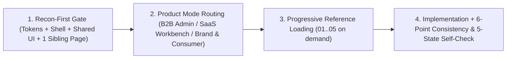

# frontend-craft (Frontend Visual System, Consistency & Architecture Spec)

English | [简体中文](README.zh-CN.md)

> A 100% self-contained, offline frontend design and engineering specification for AI coding agents. Enforces a **Recon-First Gate** on existing repositories (reusing existing tokens, layout shells, shared components, and sibling-page patterns before writing code), adapts visual density across **B2B admin ledgers, SaaS workbenches, and brand/consumer apps**, strips out recognizable **"AI-slop" aesthetics**, and enforces **5-state UX completeness**, clean **React / Vue / Svelte component & state architecture**, CJK-safe forms, and a distilled **modern native HTML/CSS baseline**.

## The Problem

When AI coding agents build or modify frontend pages across multiple sessions, five recurring failure modes degrade product quality:

- **Cross-page "patchwork monsters"**: Every newly generated route invents its own `<div class="p-6 flex ...">` header, bespoke filter bar, inconsistent table alignment, and custom status colors instead of matching sibling pages;
- **Unmistakable "AI-slop" visuals**: Purple-to-pink neon gradients, glowing card grids, 5 colored pills per row, Emoji (`🚀`, `✨`) masquerading as UI icons, and scattered magic hex/pixel literals;
- **Happy-path-only views**: Views work with 3 mock rows cleanly, then break in production—missing skeleton `Loading`, actionable `Empty` states, inline `Error` retry, long-text `Overflow` protection, or `Pending` submit locks;
- **Component & state spaghetti**: 600-line route files, stateful inline child components, server API caches manually copied into global stores, missing `AbortController` race guards, or broken Pinyin/CJK IME `Enter` submission;
- **Tooling & plugin collisions**: Relying on external CLI wrappers requires outbound network access and collides with host-native Web API reference plugins.

`frontend-craft` solves these purely offline via **progressive Markdown disclosure** (`SKILL.md` router + 5 focused `references/` modules)—coexisting cleanly alongside browser-API reference plugins such as Google's official *Modern Web Guidance*.

## Quick Trigger

- **Automatic**: Triggers whenever creating, refactoring, styling, or reviewing web UI pages, components, tables, forms, modals, design tokens, CSS, or client-side state.
- **Explicit**: `/frontend-craft` or natural language (`"frontend craft"`, `"ui spec"`, `"design system audit"`, `"anti ai slop"`, `"前端规范"`, `"UI 规范"`, `"去 AI 味"`).

## How It Works



### Progressive Reference Topology

To keep token usage low on focused edits while providing deep guardrails on full-page builds, `SKILL.md` (~170 lines) routes the agent to only the relevant module(s) under `references/`:

| Module | What It Governs |
| :--- | :--- |
| **[01-consistency-and-archetypes.md](references/01-consistency-and-archetypes.md)** | Sibling-page parity, **4 standard page skeletons** (List/Ledger, Form/Editor, Detail/Dashboard, `100dvh` Split Workbench), and **single composite contracts** (`DataTable` with `—` empty cells, right-aligned `tabular-nums`, sticky right action column with >3 actions folded into `⋯`; unified `Dialog`/`Drawer`, `EmptyState`, and `StatusBadge`) |
| **[02-ui-tokens-and-craft.md](references/02-ui-tokens-and-craft.md)** | **3-tier unidirectional tokens** (`Primitive → Semantic → Component`) + CSS `@layer`, locked font/grayscale/3-tier spacing dictionary, and **Anti-AI-Slop `Do / Don't` red lines** |
| **[03-component-and-state-arch.md](references/03-component-and-state-arch.md)** | **3-layer component graph** (`ui → features → pages`), ~250-line component complexity ceiling, **4-way state taxonomy** (Server Cache, URL Query sync, Local UI, Minimal Global Store), `AbortSignal` API layer, zero `any`, and DTO-to-ViewModel decoupling |
| **[04-ux-states-forms-a11y.md](references/04-ux-states-forms-a11y.md)** | **Mandatory 5 async states** (`Loading`, `Empty`, `Error`, `Overflow`, `Pending`), schema validation, blur-delayed `:user-invalid` error timing, **`!event.isComposing` CJK IME Enter guard**, dirty-form leave protection, and native `<button>`/`<a>` + `aria-label` semantics |
| **[05-modern-web-baseline.md](references/05-modern-web-baseline.md)** | Distilled native web baseline: `<dialog>` & `popover` over `z-index` hacks, `@container` for components, `100dvh`, `:has()`, `tabular-nums`, `text-wrap: balance/pretty`, `field-sizing`, `color-mix()`, CLS prevention, and `prefers-reduced-motion` |

## Installation

### Option 1: Install via `npx skills`

```bash
npx skills add lastxuanain/ainward-skills
```

### Option 2: Git Clone + Symlink

```bash
git clone https://github.com/lastxuanain/ainward-skills.git ~/ainward-skills

# Or link all skills automatically across installed local agents:
~/ainward-skills/scripts/link.sh

# Manual single-skill symlinks:
ln -s ~/ainward-skills/skills/frontend-craft ~/.gemini/config/skills/frontend-craft
ln -s ~/ainward-skills/skills/frontend-craft ~/.claude/skills/frontend-craft
ln -s ~/ainward-skills/skills/frontend-craft ~/.codex/skills/frontend-craft
ln -s ~/ainward-skills/skills/frontend-craft ~/.cursor/skills/frontend-craft
```

## License

Authored originally for `ainward-skills` under the [MIT License](../../LICENSE).
