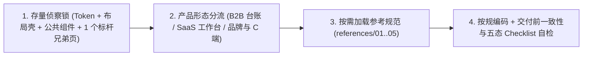

# frontend-craft（前端视觉体系、跨页一致性与工程架构规范）

[English](README.md) | 简体中文

> 100% 纯离线、零外部依赖的原创前端设计与代码架构规范 Skill。通过**存量侦察锁（Recon-First Gate）**强制先对齐项目现有 Token、布局壳、公共组件与同类型标杆兄弟页，支持 **B2B 高密度台账 / 交互式 SaaS 工作台 / 品牌落地页与 C 端**多形态自适应，系统性根除「散装缝合怪」与「AI 廉价塑料感」，并落地**数据视图五态必全、组件三层边界与状态四分法、中文输入法防误触表单细节及现代原生 HTML/CSS 编码基线**。

## 解决什么问题

让 AI Coding Agent 跨对话编写或重构前端页面时，最容易出现五大典型翻车现场：

- **项目内各页面沦为「散装缝合怪」**：每写一个新页面就用裸 `div` 重新发明一套页头、筛选栏、表格空值写法与状态胶囊配色，整个项目的间距和交互规范四分五裂；
- **一眼假「AI 廉价塑料感」**：满屏默认蓝紫霓虹渐变、高饱和发光卡片、滥用五颜六色的胶囊徽章堆砌信息、拿 Emoji（`🚀`、`✨`）充当正式产品图标，业务代码里散落魔法色值与随意像素；
- **只写 Happy Path、上线即脆断**：只测“成功返回 3 条假数据”，缺失骨架屏 `Loading`、带引导的 `Empty`、局部可重试 `Error`、超长文本防撑破 `Overflow` 以及防连点 `Pending` 锁定；
- **组件臃肿与状态泥潭**：单文件塞进五六百行与多个有状态内联子组件、把接口缓存手抄进全局 Store、筛选分页不同步 URL 刷新即丢、漏写 `!event.isComposing` 导致中文拼音回车选词误提交表单；
- **外部 CLI 依赖与插件重名冲突**：依赖联网 CLI 检索不仅受限于沙箱网络，还会与 IDE 内置的原生 Web API 检索插件撞车。

`frontend-craft` 采用纯离线 Markdown **渐进式按需加载架构**（轻量 `SKILL.md` 路由总纲 + 5 份正交模块参考文档），与宿主内置的浏览器原生 API 检索插件（如官方 `modern-web-guidance`）错位互补、零冲突共存。

## 快速触发

- **自动触发**：新建、修改、美化或重构任何前端页面、布局、组件、表格、表单、弹窗、Design Tokens、CSS 样式或客户端状态逻辑时自动生效。
- **显式调用**：`/frontend-craft`，或自然语言口令：`前端规范`、`UI 规范`、`前端视觉规范`、`前端架构规范`、`去 AI 味`、`frontend craft`、`ui spec`。

## 工作方式



### 渐进式规范模块拓扑

`SKILL.md` 控制在 ~170 行精简总纲，Agent 根据当前任务触点按需读取 `references/` 下对应的细则文档，兼顾深度约束与极低 Token 开销：

| 模块文档 | 核心治理内容 |
| :--- | :--- |
| **[01-consistency-and-archetypes.md](references/01-consistency-and-archetypes.md)** | 跨页兄弟对齐原则、**四大标准页面母版**（列表/台账页、表单/编辑页、详情/看板页、`100dvh` 双栏工作台）及**唯一复合组件契约**（唯一 `DataTable`：空值统一 `—`、金额/数量/百分比/时间右对齐且强制 `tabular-nums`、右侧固定操作列超 3 个收纳进 `⋯`；唯一弹窗/抽屉、空状态与状态徽章体系） |
| **[02-ui-tokens-and-craft.md](references/02-ui-tokens-and-craft.md)** | **三级单向变量纪律**（`Primitive -> Semantic -> Component`）+ CSS `@layer`、锁死字体栈/唯一灰阶/三级间距字典，以及**反 AI 廉价塑料感红线（Do / Don't 对照表）** |
| **[03-component-and-state-arch.md](references/03-component-and-state-arch.md)** | 兼容 React / Vue / Svelte 的**三层组件职责边界**（`ui -> features -> pages`）、单组件 250 行拆分警戒线、**状态四分法**（服务端缓存 / URL Query 同步 / 局部 UI / 极简全局 Store）、API 竞态取消与严格 TS 类型解耦（禁裸 `any`） |
| **[04-ux-states-forms-a11y.md](references/04-ux-states-forms-a11y.md)** | **异步视图五态必全契约**（`Loading / Empty / Error / Overflow / Pending`）、Schema 校验、失焦延迟报错（禁开屏满眼飘红）、**中文输入法 `!event.isComposing` 回车防误提交**、脏表单离开拦截，以及原生 `<button>`/`<a>` + 纯图标 `aria-label` 无障碍与自动化测试语义 |
| **[05-modern-web-baseline.md](references/05-modern-web-baseline.md)** | 浓缩现代原生 Web 基线：`<dialog>` / `popover` 替代 `z-index` 补丁、组件 `@container` 容器查询、`100dvh`、`:has()` 关联选择器、`tabular-nums`、`text-wrap: balance/pretty`、`field-sizing`、`color-mix()` 动态混色、媒体防 CLS 与 `prefers-reduced-motion` |

## 安装

### 方式一：使用 `npx skills`

```bash
npx skills add lastxuanain/ainward-skills
```

### 方式二：Git 克隆 + 软链接

```bash
git clone https://github.com/lastxuanain/ainward-skills.git ~/ainward-skills

# 一键自动挂载到本机已安装的各 Agent 工具（Antigravity / Claude Code / Codex / OpenCode / Cursor）
~/ainward-skills/scripts/link.sh

# 或手动按需软链接单个技能：
ln -s ~/ainward-skills/skills/frontend-craft ~/.gemini/config/skills/frontend-craft
ln -s ~/ainward-skills/skills/frontend-craft ~/.claude/skills/frontend-craft
ln -s ~/ainward-skills/skills/frontend-craft ~/.codex/skills/frontend-craft
ln -s ~/ainward-skills/skills/frontend-craft ~/.cursor/skills/frontend-craft
```

## 许可证

本技能由 Ainward 原创编写，遵循仓库根目录 [MIT 许可证](../../LICENSE)。
