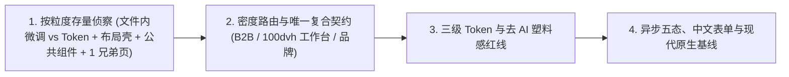

# frontend-craft（前端视觉一致性、去 AI 味与工程交互护栏）

[English](README.md) | 简体中文

> 纯离线、单文件高信噪比的前端设计与工程护栏 Skill（`v2.0.0`）。按改动粒度自适应执行**存量侦察**，支持 **B2B 高密度台账、`100dvh` 双栏工作台与品牌/C 端**密度路由，根除「散装缝合怪」与「AI 廉价塑料感」，落地**异步视图五态必全、中文输入法防误提交表单、React / Vue / Svelte 状态边界与现代原生 HTML/CSS 基线**——零外部子文件读取开销、零越界劫持。

## 触发与边界

- **自动生效**：新建、重设计或重构多元素 Web 页面、布局壳、数据表格、表单、弹窗或 Design Tokens 时生效。
- **显式口令**：`/frontend-craft`、`前端规范`、`UI 规范`、`去 AI 味`、`frontend craft`、`ui spec`。
- **严格非目标边界**：**绝不劫持**只读代码审查（`/agent-review`）、跨分支同步（`/code-sync`）、纯非视觉 TS/状态工具逻辑、后端/脚本配置，以及 **1 行级局部样式/文案微调**（局部微调直接对齐当前文件上下文，严禁顺手改写或拆分未触碰的历史代码）。

## 工作方式



### 核心护栏速览

- **跨页对齐与复合组件契约**：优先复用/扩展现有 `PageShell`、唯一 `DataTable`（空值统一 `—`、金额/数量/百分比/时间右对齐且 `tabular-nums`、右侧固定操作列超 3 项折叠进 `⋯`）、`Dialog`（`≤ 5` 项短表单/确认）与 `Drawer`（`> 5` 项编辑/预览/日志）及全局单一 `StatusBadge` 语义映射；单列表单限宽 `640px–800px`，B2B 列表禁放大号指标卡把表格挤出首屏，非对称 CSS Grid 强制 `minmax(0, ...)` 防宽内容撑破视口。
- **三级 Token 与去 AI 味红线**：严守 `Primitive -> Semantic -> Component` 单向变量与 `@layer`（单一中性灰阶 + `90 / 8 / 2` 配比）；硬性拦截蓝紫霓虹渐变、高饱和发光/多层套娃卡片、单行堆砌多个彩色胶囊、魔法色值/像素以及拿 Emoji（`🚀✨`）充当 UI 图标。
- **异步五态与中文表单实战**：强制覆盖 `Loading`（骨架屏/`keepPreviousData`，禁筛选翻页全屏遮罩转圈）、双场景 `Empty`（首次创建引导 vs 清空筛选）、局部 `Error` + `Retry`（严禁 `catch -> return []` 吞错伪装空数据）、`Overflow`（`min-w-0` + `truncate`）与 `Pending` 防连点回滚；执行失焦延迟报错（`:user-invalid`，禁开屏满眼飘红）、React/原生通用中文输入法回车防误提交（`(e.nativeEvent?.isComposing ?? e.isComposing) || e.keyCode === 229`）、脏表单离开拦截，以及 `<button type="button">` / `<a href>` + 纯图标 `aria-label` 语义。
- **组件状态边界与现代原生基线**：严守 `pages -> features -> ui` 单向依赖、列表筛选/排序/分页/Tab 同步 URL 参数、渲染期同步计算派生状态（禁 `useEffect`/`watch` -> `setState` 镜像同步）与搜索 `AbortSignal` 竞态保护；原生 `<dialog>` 强制调用 `ref.showModal()`/`close()`（严禁绑定 `<dialog open={isOpen}>`），优先采用 `popover`、`@container`、`100dvh`、`:has()`、`field-sizing: content`、`color-mix(in oklab)`、媒体 `aspect-ratio` 防 CLS 与 `prefers-reduced-motion`。

## 安装

```bash
npx skills add lastxuanain/ainward-skills
# 或克隆后一键同步本机软链接（纯后端环境可加 --exclude frontend-craft）：
../../scripts/link.sh
```

完整配置方式详见[仓库根目录 README](../../README.zh-CN.md)。

## 许可证

遵循仓库根目录 [MIT 许可证](../../LICENSE)。
