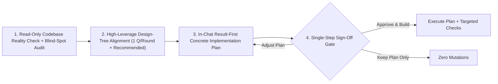

# plan-review (Pre-Implementation Plan Review & Requirement Alignment)

English | [简体中文](README.zh-CN.md)

> Low-cognitive-load pre-implementation plan review, requirement alignment, and codebase-grounded course correction. Inspects the actual repository and project rules read-only first, proactively hunts blind spots and edge cases, pushes back candidly against flawed or over-engineered directions (anti-sycophancy), interviews you **only on high-leverage directional decisions** (1 question per round by default with `(Recommended)` options while the agent owns routine implementation details), and delivers a **Result-First concrete implementation plan** in chat behind a single-step sign-off gate.

## The Problem

Before letting an AI coding agent edit code on a rough idea or an unverified plan, four common failure modes get in the way:

- **Blind coding on vague prompts**: Most coding agents do not ship with a built-in pre-coding alignment workflow—they guess silently on missing requirements and build in the wrong direction;
- **Interrogation fatigue**: Traditional "grill me" prompts relentlessly drill into low-level implementation trivia or dump walls of 7–8 questions at once, exhausting the developer;
- **Sycophantic compliance without reality checks**: Agents eagerly agree with flawed, redundant, or over-engineered proposals without first checking the real codebase for architectural conflicts or reusable abstractions;
- **Cross-agent fragmentation & command collisions**: While some tools ship a built-in `/grill-me` command, Claude Code, Codex, and Cursor do not—and copying a tool-specific wrapper breaks across hosts.

`plan-review` completes the pre-coding entry gate of `ainward-skills` (deliberately named `plan-review` to avoid colliding with Antigravity's built-in `/grill-me` while retaining `"grill-me"` as a natural-language trigger): **you own the big direction; the agent checks codebase reality, fills blind spots, pushes back honestly, owns routine details, and hands you an execution-ready plan**.

## Quick Trigger

Primarily **explicitly invoked** (so routine, unambiguous coding tasks are never interrupted by unwanted interrogations):

- `/plan-review`
- Natural language: `"plan review"`, `"review my plan"`, `"align requirements"`, `"stress-test my plan"`, `"spec check"`, `"grill-me"`, `"grill me"`, `"方案评审"`, `"需求纠偏"`, `"对齐需求"`, `"梳理方案"`, `"补全需求"`, `"拷问方案"`

> **Tip**: Because it uses the distinct name `plan-review`, it coexists cleanly alongside Antigravity's built-in `/grill-me` while giving Claude Code, Codex, and Cursor the same structured recommendation-card UX (with graceful plain-text fallback).

## How It Works



### 1. Codebase Reality First, Blind-Spot Hunting & Candid Pushback

- **Facts belong to the agent, never the user**: Before asking any question, the agent reads repository rules (`CLAUDE.md`, `AGENTS.md`, `GEMINI.md`, etc.) and the relevant source code, shared helpers, and callers—never asking anything verifiable from the repo.
- **Course correction & anti-sycophancy**: Zero hollow praise. When a proposal conflicts with existing architecture, reinvents a shared helper, or introduces obvious flaws or over-engineering, the agent cites real code evidence and lays out **what is wrong → concrete consequence → recommended alternative**, leaving the final call with you.
- **Proactive blind-spot coverage**: Surfaces missed edge cases, upstream/downstream impacts, authz/state transitions, failure semantics, and compatibility risks—handling routine safeguards autonomously and escalating only directional calls.

### 2. Human Owns Direction; Agent Owns Implementation Details

- **1 question per round by default, zero trivia**: Walks down the dependency-ordered design tree asking only high-leverage directional choices (goals, non-goals, user-visible behavior, public contracts, risk trade-offs)—batching at most 2–3 choices only when lightweight and strictly independent. Naming, helper splits, and standard repo conventions are handled autonomously by the agent.
- **Every question has a `(Recommended)` option**: Uses native structured cards (`ask_question` / `AskUserQuestion`) when available and degrades cleanly to numbered `❓ / ➡️` plain text otherwise. Say `"give me the plan"` / `"直接出方案"` anytime to converge immediately using recommended defaults.

### 3. In-Chat Concrete Implementation Plan & Single-Step Sign-Off

- **Zero workspace clutter**: Delivers the complete execution-ready plan directly in chat (goals & non-goals, aligned decisions, reality corrections & filled blind spots, agent-owned implementation details with short filenames, ordered execution steps, and acceptance/verification checks)—never dropping unsolicited `PLAN*.md` files to disk unless you ask.
- **Strict pre-code gate & downstream handoff**: Closes with **one** sign-off card (`Approve & start implementation` / `Adjust plan` / `Keep plan only`). Its concrete goals and acceptance checks feed naturally into [`work-report`](../work-report/README.md) and [`agent-review`](../agent-review/README.md) after coding.

## Installation

### Option 1: Install via `npx skills`

```bash
npx skills add lastxuanain/ainward-skills
```

### Option 2: Git Clone + Symlink

```bash
git clone https://github.com/lastxuanain/ainward-skills.git ~/ainward-skills

# Antigravity
mkdir -p ~/.gemini/config/skills
ln -s ~/ainward-skills/skills/plan-review ~/.gemini/config/skills/plan-review

# Claude Code
mkdir -p ~/.claude/skills
ln -s ~/ainward-skills/skills/plan-review ~/.claude/skills/plan-review

# Codex
mkdir -p ~/.codex/skills
ln -s ~/ainward-skills/skills/plan-review ~/.codex/skills/plan-review

# Cursor
mkdir -p ~/.cursor/skills
ln -s ~/ainward-skills/skills/plan-review ~/.cursor/skills/plan-review
```

## Inspiration & Attribution

Authored originally for `ainward-skills` under the MIT License. Its dependency-ordered design-tree exploration, "agent checks codebase facts," and strict pre-approval stop boundary draw conceptual inspiration from Matt Pocock's `grilling` skill in [`mattpocock/skills`](https://github.com/mattpocock/skills) (MIT License), combined with Antigravity's structured interactive recommendation UX—re-engineered around low cognitive load, direction-only escalation, codebase-grounded anti-sycophancy pushback, and actionable implementation-plan delivery.
