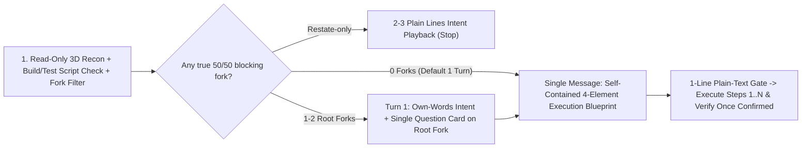

# plan-review (Pre-Code Alignment & Self-Contained Execution Blueprint)

English | [简体中文](README.zh-CN.md)

> **Proposal-first, self-contained** pre-code alignment: inspects source modules, 3D callers, schemas, and real build/test scripts read-only first, plays back the **root problem and goal in 2–3 plain sentences** (penetrating XY drift and locking `Non-Goals`), and **converges in 1 turn by default** (`2` turns max on genuine forks) on a **complete 4-element execution blueprint** in chat—staying 100% read-only until explicitly confirmed.

## The Problem

- **False alignment & XY drift**: Agents parrot surface prompts back to you or implement prescribed mechanism `Y` while missing root problem `X` and scope boundaries;
- **Interrogation fatigue vs. hand-wavy half-plans**: Traditional flows either trap you in 4–5 rounds of padded questions or emit vague sketches (`"update related callers and run unit tests"`) that miss companion files and break across `/compact`;
- **Premature coding**: Jumping straight into file edits right after a fork answer or `"align then fix"` prompt before you ever see and approve the full execution plan.

## Quick Trigger

Explicitly invoked (never hijacking clear routine coding prompts):

- `/plan-review` or natural language: `"plan review"`, `"align requirements"`, `"in-your-own-words"`, `"方案评审"`, `"需求纠偏"`, `"对齐需求"`, `"复述需求"`
- **Restate-only**: say `"restate in your own words first, no plan yet"` to get the 2–3 sentence intent playback + reality check and stop cleanly.

## How It Works

- **4-Element Blueprint + 3 Anti-Handwaving Guarantees** (cuts conversational filler while keeping full engineering rigor; Turn 2 folds settled fork decisions into one standalone message that survives `/compact` or agent handoff):
  1. **Intent, Course Correction & Non-Goals**: 2–3 plain sentences stating `Problem + Goal`, explicit `Non-Goals`, and candid `[file.ts](file:///...#L...)` pushback (`what is wrong → consequence → better alternative`) against architectural conflicts;
  2. **Complete File & Contract Inventory**: Every touched file tagged `[新增]`/`[修改]`/`[删除]` with clickable `[file.ts](file:///...#L...)` links and signature/type/schema/state contract changes (**bans `"etc. / update callers as needed / path/*"`**);
  3. **Ordered Execution Steps `1..N`**: Dependency-ordered steps with concrete logic changes and AI-owned error, edge-case, compatibility, and concurrency safeguards (**zero execution-time guesswork**);
  4. **Executable Verification Plan**: Exact copy-pasteable commands grounded in repo scripts + pass criteria, or explicit CLI/manual steps when no test harness exists (**bans vague `"run relevant tests"`**).
- **Hard Pre-Code Stop**: Never edits code in the turn that first emits the complete plan, never drops unsolicited `PLAN*.md` files to disk, and stops with 1 plain-text line (`zero` sign-off popups).

## Installation

Install via `npx skills add lastxuanain/ainward-skills`, or clone the repo and run [`../../scripts/link.sh`](../../scripts/link.sh) (see the [root README](../../README.md)).

## Inspiration & Attribution

Authored originally for `ainward-skills` under the MIT License:
- Plain-language intent playback and exception-driven autonomy draw conceptual inspiration from Lauren Tan (`@poteto`)'s `in-your-own-words` skill and engineering principles in [`cursor/plugins` (`pstack`)](https://github.com/cursor/plugins/tree/main/pstack) (MIT License);
- Codebase-facts-first discipline and pre-code read-only boundaries draw inspiration from Matt Pocock's [`mattpocock/skills`](https://github.com/mattpocock/skills) (MIT License), paired with a self-contained 4-element execution blueprint.
