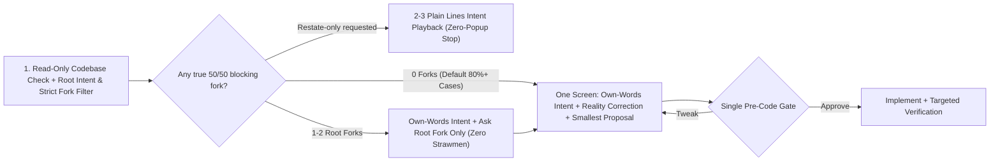

# plan-review (Proposal-First Intent Playback & Pre-Code Course Correction)

English | [简体中文](README.zh-CN.md)

> **Proposal-first, ultra-low-cognitive-load** pre-implementation alignment and codebase-grounded course correction. Reads the real repository first, **plays back the underlying problem and desired outcome in 2–3 plain sentences** (penetrating XY problems without parroting or sycophancy), owns secondary trade-offs autonomously instead of running multi-round questionnaire theater, and **converges in 1 turn by default** (asking at most 1–2 true blocking forks when genuinely split, or stopping cleanly on restate-only requests) before touching code.

## The Problem

Before letting an AI coding agent edit code on a rough idea, a noisy issue thread, or an unverified plan, four failure modes get in the way:

- **False alignment & XY drift**: Agents parrot your surface prompt back to you or blindly implement prescribed mechanism `Y` while missing root problem `X`;
- **Multi-round approval theater**: Traditional `/grill-me` workflows split secondary choices into 4–5 rounds of padded multiple-choice questions and finish with a repetitive 5-section bureaucratic spec wall, draining developer focus;
- **Sycophantic compliance without reality checks**: Agents praise flawed or over-engineered proposals without checking the real codebase for conflicts or reusable abstractions;
- **Cross-agent fragmentation & command collisions**: Built-in alignment commands vary wildly across coding agents or collide with host slash commands.

`plan-review` (named to coexist cleanly with Antigravity's built-in `/grill-me` while supporting both `"grill-me"` and `"in-your-own-words"` triggers) shifts pre-coding alignment to **management by exception**: **the agent checks repo facts, states the real problem in plain words, and puts the smallest sound proposal directly on the table—closing in 1 turn when clear, 2 turns max when a true fork exists**.

## Quick Trigger

Explicitly invoked (never hijacking routine, clear coding tasks):

- `/plan-review`
- Natural language: `"plan review"`, `"review my plan"`, `"align requirements"`, `"restate requirements"`, `"in-your-own-words"`, `"in your own words"`, `"stress-test my plan"`, `"spec check"`, `"grill-me"`, `"grill me"`, `"方案评审"`, `"需求纠偏"`, `"对齐需求"`, `"复述需求"`, `"理清需求"`

> **Tip**: When facing a noisy bug report or Slack thread and you **only** want the agent to distill the real problem first without proposing a plan yet, say `"restate in your own words first, no plan yet"` / `"先用你自己的话复述一下，暂不出方案"`—it outputs the plain-words playback + reality notes and stops with zero modal popups.

## How It Works



### 1. Codebase Facts First & 2–3 Sentence Own-Words Playback

- **Facts belong to the agent**: Reads repo rules (`CLAUDE.md`, `AGENTS.md`, `GEMINI.md`, etc.) and relevant source files/callers before speaking—never asking anything verifiable from code.
- **Anti-parroting & XY penetration**: Opens with 2–3 plain sentences in the agent's own words stating **what hurts now (`Problem`)** and **what observable outcome is wanted (`Goal`)**; separates prescribed mechanisms from root problems and pushes back candidly (`what's wrong → consequence → alternative` with `file#L` proof) whenever a premise conflicts with reality.

### 2. Proposal-First by Default (Zero Interrogation Theater)

- **Strict Fork Filter**: Naming, repo conventions, and **secondary design choices with a clear winner** are decided autonomously by the agent and stated transparently in the proposal—eliminating 4–5 round clicking marathons and strawman options.
- **Escalate only true forks (2-turn max)**: Asks an upfront recommendation card **only** when 2+ viable paths materially alter user-visible behavior, public contracts, irreversible risk, or the core meaning of an ambiguous prompt.

### 3. Proportional Shape & Strict Pre-Code Gate

- **No 5-section boilerplate walls**: Small changes take 6–10 crisp lines (own-words problem/goal, smallest changes with short filenames, verification); larger changes scale proportionally without empty headings, repeated prose, or unsolicited `PLAN*.md` scratch files on disk.
- **Clean handoff**: Strictly read-only until approved; once implemented, pairs naturally with [`work-report`](../work-report/README.md) and [`agent-review`](../agent-review/README.md).

## Installation

### Option 1: Install via `npx skills`

```bash
npx skills add lastxuanain/ainward-skills
```

### Option 2: Git Clone + Symlink

```bash
git clone https://github.com/lastxuanain/ainward-skills.git ~/ainward-skills

# Antigravity
mkdir -p ~/.gemini/config/skills
ln -s ~/ainward-skills/skills/plan-review ~/.gemini/config/skills/plan-review

# Claude Code
mkdir -p ~/.claude/skills
ln -s ~/ainward-skills/skills/plan-review ~/.claude/skills/plan-review

# Codex
mkdir -p ~/.codex/skills
ln -s ~/ainward-skills/skills/plan-review ~/.codex/skills/plan-review

# Cursor
mkdir -p ~/.cursor/skills
ln -s ~/ainward-skills/skills/plan-review ~/.cursor/skills/plan-review
```

## Inspiration & Attribution

Authored originally for `ainward-skills` under the MIT License:
- Its plain-language intent playback ("restate the underlying problem and goal in your own words so misreadings surface in one message") and exception-driven autonomy draw conceptual inspiration from Lauren Tan (`@poteto`)'s `in-your-own-words` skill and engineering principles in [`cursor/plugins` (`pstack`)](https://github.com/cursor/plugins/tree/main/pstack) (MIT License);
- Its "agent checks codebase facts" and pre-code stop boundary draw inspiration from Matt Pocock's [`mattpocock/skills`](https://github.com/mattpocock/skills) (MIT License), refactored away from multi-round interrogation fatigue into a **1-turn proposal-first** workflow.
