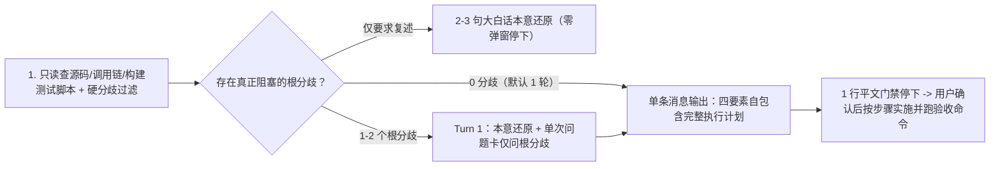

# plan-review（编码前本意对焦与完整执行方案收敛）

[English](README.md) | 简体中文

> **提案驱动（Proposal-First）、单条自包含**的编码前对焦工作流：动笔前先只读深挖真实源码、上下游调用链与测试脚本，用 AI 自己的 **2–3 句大白话还原真实痛点与目标**（穿透 XY 问题、划清 `Non-Goals`），**默认 1 轮（有硬分歧最多 2 轮）在对话内输出一份可直接独立执行的四要素完整计划**，并在显式确认前严格保持只读。

## 解决什么问题

- **假性共识与 XY 跑偏**：AI 把表面指令换词复读就猛写，或盲从用户指定的手段（Y）却漏掉真问题（X）与边界控制；
- **连环盘问与含糊半成品方案**：要么把次级细节拆成四五轮多选题逼人连点，要么只给几句轻飘飘的「改某文件等相关模块、跑相关单测」，一开写就漏改调用方或经不起 `/compact` 压缩；
- **未看完整方案就擅自动手**：回答完分歧问题或顺口说了句「对齐完直接改」，AI 就跳过完整计划确认直接改代码。

## 快速触发

显式触发（绝不劫持日常明确的小改动）：

- `/plan-review` 或自然语言：`方案评审`、`需求纠偏`、`对齐需求`、`复述需求`、`in-your-own-words`、`plan review`、`align requirements`
- **仅复述理清**：说「先用你自己的话复述一下，暂不出方案」，输出 2–3 句本意还原与现实提示后零弹窗停下。

## 工作方式

- **四要素闭环 + 三条反敷衍红线**（砍空话套话，绝不砍工程闭环；Turn 2 合并已拍板分歧输出单条自包含计划，无缝扛住 `/compact` 或跨 Agent 交接）：
  1. **本意、纠偏与边界**：2–3 句大白话还原 `Problem + Goal`、明确 `Non-Goals`，架构冲突或重复造轮子时带可点击 `[file.ts](file:///...#L...)` 直指「错在哪 → 后果 → 更优解」；
  2. **全量改动文件与契约清单**：逐一标注 `[新增]/[修改]/[删除]` + 可点击 `[file.ts](file:///...#L...)` 与签名/类型/状态契约变更（**禁写「等相关文件 / 按需改调用方 / 通配符」**）；
  3. **有序执行步骤 `1..N` 与兜底**：按依赖序给出具体改动与异常/边界/兼容/并发保护（**禁止执行期再靠猜**）；
  4. **可执行验收方案**：基于仓库真实脚本给出可复制命令与通过判据，无测试基建则写明具体 CLI/手动验证路径（**禁写「运行相关单测」空话**）。
- **硬性编码前门禁**：完整计划未获确认前严格只读、不落盘 `PLAN*.md` 草稿、不弹多余确认卡（统一以 1 行平文提示收尾）。

## 安装

使用 `npx skills add lastxuanain/ainward-skills`，或克隆仓库后运行根目录一键软链接脚本 [`../../scripts/link.sh`](../../scripts/link.sh)（详见[主仓库文档](../../README.zh-CN.md)）。

## 灵感与致谢

本技能由 Ainward 原创编写（MIT 协议）：
- 「用自己的话还原真实痛点与目标让偏差首轮暴露」与「按例外纠偏」受到 Lauren Tan（`@poteto`）在 [`cursor/plugins` (`pstack`)](https://github.com/cursor/plugins/tree/main/pstack)（MIT License）中 `in-your-own-words` 与工程原则的启发；
- 「查事实归 AI、未达成共识前只读不动手」的边界意识受到 Matt Pocock [`mattpocock/skills`](https://github.com/mattpocock/skills)（MIT License）的启发，并结合单条自包含完整执行蓝图重构。
