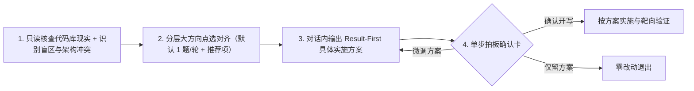

# plan-review（编码前方案评审与需求纠偏）

[English](README.md) | 简体中文

> 面向编码前的低心智负担需求对齐、方案评审与现实纠偏工作流。动笔前先只读核查真实代码库与项目规则，主动挖掘遗漏的盲区与边界风险，对存在缺陷或过度设计的方向直言纠偏（拒绝谄媚盲从）；全程只把**高杠杆大方向决策**以推荐点选卡交给人类拍板（默认 1 题/轮，低层实现细节由 AI 自主扛下），对齐后直接在对话内输出一份可落地的 **Result-First 具体实施方案**，经单步确认后再动手写代码。

## 解决什么问题

在把一个模糊想法或初步方案交给 AI Coding Agent 直接开写之前，常见四个痛点：

- **直接盲写、越写越偏**：很多 Coding Agent 默认不带需求对齐流程，拿到一句模糊需求就凭猜测猛写，改完才发现方向、边界或与现有架构的契合度全不对；
- **盘问太碎、认知负担爆表**：传统拷问式 Prompt 喜欢把每个函数命名、细枝末节都追问一遍，甚至一轮甩出七八个问题，让开发者疲于作答；
- **盲从谄媚、不看项目现实**：AI 经常一边夸“好想法”一边照单全收有隐患或过度设计的方案，却不先读代码库核对是否与现有抽象冲突、有没有现成组件可复用；
- **多工具割裂与命令撞车**：部分工具内置了 `/grill-me`，但 Claude Code / Codex / Cursor 等工具并无内置能力，且不同工具的交互能力参差不齐。

`plan-review` 补齐了 `ainward-skills` 的**编码前入口**（命名主动避开 Antigravity 内置 `/grill-me` 冲突，同时在自然语言触发词中保留 `grill-me`）：**人只抓大方向，AI 查现实、补盲区、敢纠偏、扛细节**，对齐完直接给出一份拿来就能干的具体实施方案。

## 快速触发

以**显式触发为主**（避免日常明确的小改动被频繁盘问打断），安装后可直接输入：

- `/plan-review`
- 自然语言口令：`方案评审`、`需求纠偏`、`对齐需求`、`梳理方案`、`补全需求`、`拷问方案`、`评审一下方案`、`grill-me`、`grill me`

> **提示**：采用 `plan-review` 命名后，在 Antigravity 中可与内置 `/grill-me` 无冲突共存；在 Claude Code / Codex / Cursor 中也能开箱获得结构化推荐点选（或自动降级为编号推荐选项）的跨工具一致体验。

## 工作方式



### 1. 先查代码库现实，主动补盲区、敢纠偏

- **查事实永远是 AI 的活**：开口提问前必先只读检查仓库规则（`CLAUDE.md` / `AGENTS.md` / `GEMINI.md` 等）与相关源码、共享组件和调用链；能查代码库回答的问题绝不反问用户。
- **基于现实纠偏 + 反谄媚**：若你的提议与现有架构冲突、重复造轮子、存在明显缺陷或过度设计，AI 会直接拿代码证据指出 **错在哪 → 具体后果 → 替代方案**，不讲空话客套，把最终决断权交给你。
- **主动补盲区**：面对模糊需求，主动扫描边界条件、上下游依赖、权限与状态流转、失败语义及兼容性风险，把常规兜底自己扛下，只把需要人拍板的盲区摆上台面。

### 2. 人抓大方向、AI 扛细节，最低心智负担推进

- **默认 1 题/轮，绝不问实现琐事**：沿设计树按依赖顺序只问高杠杆大方向（目标、非目标、用户可见行为、核心契约与风险取舍）；仅在出现 2–3 个极轻且互不依赖的独立偏好时才合并进同一张多题卡。函数命名、局部文件拆分等实现细节由 AI 按仓库惯例自主决策。
- **每题自带 `(Recommended)` 推荐答案**：支持 `ask_question` / `AskUserQuestion` 的宿主直接一键点选，无结构化卡片的宿主自动降级为清晰编号选项 + `➡️ 推荐` 提示；随时说 **「直接出方案」** 即可立刻按推荐项收敛。

### 3. 对话内输出具体实施方案 + 单步门禁

- **不污染工作区**：默认仅在对话内呈现结构化、可执行的 Result-First 实施方案（含目标与非目标、已拍板方向、纠偏与盲区补全记录、AI 自主决策的实施细节与短文件名、分步步骤与验收验证），绝不擅自往仓库写未跟踪的 `PLAN*.md` 草稿（仅在你显式要求保存时落盘）。
- **未拍板不动手 + 下游无缝衔接**：方案末尾只弹 **1 张单步确认卡**（`确认开写` / `微调方案` / `仅留方案不动手`）。方案里的目标与验收标准可直接无缝承接后续的 [`work-report`](../work-report/README.zh-CN.md) 与 [`agent-review`](../agent-review/README.zh-CN.md)。

## 安装

### 方式一：使用 `npx skills`

```bash
npx skills add lastxuanain/ainward-skills
```

### 方式二：Git 克隆 + 软链接

```bash
git clone https://github.com/lastxuanain/ainward-skills.git ~/ainward-skills

# Antigravity
mkdir -p ~/.gemini/config/skills
ln -s ~/ainward-skills/skills/plan-review ~/.gemini/config/skills/plan-review

# Claude Code
mkdir -p ~/.claude/skills
ln -s ~/ainward-skills/skills/plan-review ~/.claude/skills/plan-review

# Codex
mkdir -p ~/.codex/skills
ln -s ~/ainward-skills/skills/plan-review ~/.codex/skills/plan-review

# Cursor
mkdir -p ~/.cursor/skills
ln -s ~/ainward-skills/skills/plan-review ~/.cursor/skills/plan-review
```

## 灵感与致谢

本技能由 Ainward 原创编写（MIT 协议），其「设计树分层推进、查事实不问用户、未达成共识前不动手」的底层思路受到 Matt Pocock 开源仓库 [`mattpocock/skills`](https://github.com/mattpocock/skills)（MIT License）中 `grilling` 技能的启发，并融合了 Antigravity 结构化推荐点选交互体验，围绕**低认知负担、只问大方向、基于代码库现实反谄媚纠偏与具体实施方案交付**进行了全面重构。
