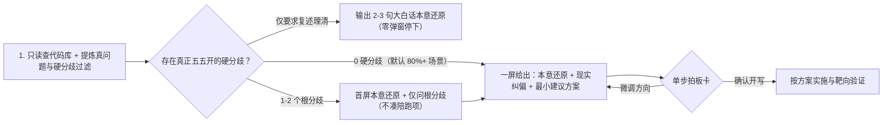

# plan-review（编码前本意对焦与极简方案纠偏）

[English](README.md) | 简体中文

> **提案驱动（Proposal-First）、极低认知负担**的编码前对焦与现实纠偏工作流。动笔前先只读核查真实代码库，**用 AI 自己的 2–3 句大白话还原「真实痛点与目标」**（穿透 XY 问题、拒绝字面复读与谄媚盲从）；次级权衡与实现细节由 AI 直接给出推荐最优解，**默认 1 轮一屏完成对焦与拍板**（仅在出现真正五五开的硬分歧时才问 1–2 个根问题，也支持仅复述理清零弹窗收尾），彻底告别连环问卷盘问与五段式八股公文。

## 解决什么问题

在把模糊想法、嘈杂报错贴或初步方案交给 AI 直接写代码前，常见四个痛点：

- **假性共识与 XY 跑偏**：AI 把表面指令换词复读一遍就猛写，或盲目照做用户顺口指定的手段（Y）却漏掉背后的真问题（X）；
- **连环问卷审讯（Approval Theatre）**：传统 `/grill-me` 式流程把次级细节拆成四五轮多选题逼人连点确认，最后再甩出一大篇重复的五段式立项八股文，造成严重的点击与阅读疲劳；
- **盲从谄媚、不看项目现实**：AI 一边夸“好想法”一边照单全收与现有架构冲突或过度设计的提议，不先读源码核对现成抽象；
- **多工具体验割裂**：不同 Coding Agent 的内置对齐能力参差不齐，且命令命名容易撞车。

`plan-review`（命名主动避开 Antigravity 内置 `/grill-me` 冲突，同时兼容 `grill-me` 与 `in-your-own-words` 口令）将编码前交互重构为 **「按例外纠偏（Course-Correct by Exception）」**：**AI 查事实、还原真问题、直接给最小可行方案；没硬分歧 1 轮拍板，有硬分歧最多 2 轮收敛**。

## 快速触发

显式触发（不打扰日常明确的小改动）：

- `/plan-review`
- 自然语言：`方案评审`、`需求纠偏`、`对齐需求`、`复述需求`、`理清需求`、`梳理方案`、`补全需求`、`拷问方案`、`in-your-own-words`、`in your own words`、`restate requirements`、`grill-me`、`grill me`

> **提示**：若面对长串讨论只想**先让 AI 用大白话理清核心问题、暂不出方案**，直接说「先用你自己的话复述一下，暂不出方案」，AI 会在输出本意还原与关键现实提示后直接零弹窗停下。

## 工作方式



### 1. 先查代码库现实，2–3 句大白话暴露真问题

- **查事实永远归 AI**：开口前先只读检查仓库规则（`CLAUDE.md` / `AGENTS.md` / `GEMINI.md` 等）与相关源码、共享组件和调用链，能查代码搞清的绝不反问。
- **反字面复读 + XY 穿透**：开篇固定用 AI 自己的 2–3 句大白话讲清 **「当前卡在哪（Problem）+ 期望最终效果（Goal）」**；若用户点名了具体改法，拆开「表面手段 vs 背后真问题」；若有架构冲突或过度设计，直接带 `file#L` 证据指出 **错在哪 → 后果 → 替代方案**。

### 2. 默认一屏给最优提案，严禁连环问卷盘问

- **硬分歧过滤器（Strict Fork Filter）**：函数命名、仓库惯例以及**有明确更优解的次级设计取舍**全部由 AI 自主拍板并透明写入建议方案，人类只需对不满意的点按例外微调，不再陪跑 4–5 轮多选题。
- **仅对真分歧提问（最多 2 轮收敛）**：只有当两条路线会导致截然不同的外部行为、公共契约、不可逆风险，或嘈杂上下文存在多种核心理解时，才用推荐卡问那 **1 个（极少 2 个）** 阻塞性根分歧。

### 3. 篇幅随复杂度自然伸缩，未拍板不动手

- **拒绝五段式八股文**：小改动 6–10 行说清（本意还原 + 最小改动短文件名 + 验证方式），复杂跨模块改造才按模块分点展开；不刷空标题，不把刚点过的选项换公文腔重抄一遍，也不擅自往磁盘写 `PLAN*.md` 污染工作区。
- **单步门禁与下游衔接**：未确认前严格只读；确认后实施并跑靶向验证，后续可自然衔接 [`work-report`](../work-report/README.zh-CN.md) 与 [`agent-review`](../agent-review/README.zh-CN.md)。

## 安装

### 方式一：使用 `npx skills`

```bash
npx skills add lastxuanain/ainward-skills
```

### 方式二：Git 克隆 + 软链接

```bash
git clone https://github.com/lastxuanain/ainward-skills.git ~/ainward-skills

# Antigravity
mkdir -p ~/.gemini/config/skills
ln -s ~/ainward-skills/skills/plan-review ~/.gemini/config/skills/plan-review

# Claude Code
mkdir -p ~/.claude/skills
ln -s ~/ainward-skills/skills/plan-review ~/.claude/skills/plan-review

# Codex
mkdir -p ~/.codex/skills
ln -s ~/ainward-skills/skills/plan-review ~/.codex/skills/plan-review

# Cursor
mkdir -p ~/.cursor/skills
ln -s ~/ainward-skills/skills/plan-review ~/.cursor/skills/plan-review
```

## 灵感与致谢

本技能由 Ainward 原创编写（MIT 协议）：
- 「先用自己的话复述真实痛点与目标让偏差在第一回合暴露，以及拒绝无谓阻塞人类（按例外纠偏）」的思想受到 Lauren Tan（`@poteto`）在 [`cursor/plugins` (`pstack`)](https://github.com/cursor/plugins/tree/main/pstack)（MIT License）中 `in-your-own-words` 与工程原则的启发；
- 「查事实归 AI、未达成共识前不动手」的边界意识受到 Matt Pocock [`mattpocock/skills`](https://github.com/mattpocock/skills)（MIT License）的启发，并针对传统多轮盘问认知过重的问题重构为**默认一屏提案驱动**架构。
