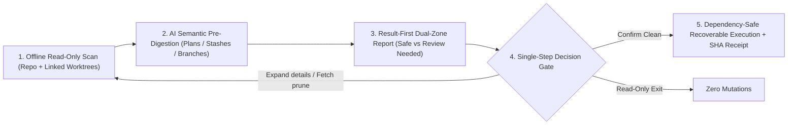

# repo-clean (Low-Cognitive-Load Repository & Workspace Cleanup)

English | [简体中文](README.zh-CN.md)

> Low-cognitive-load repository hygiene and workspace cleanup workflow for Git repositories after remote branch merges or parallel multi-agent tasks. Scans the current repository and all linked `git worktree list` checkouts read-only and offline, pre-reads untracked planning/deduction docs, stashes, and unmerged branches to verify semantic landing against your base branch, and delivers a **Result-First dual-zone summary**—so you only ever spend attention on genuinely uncertain items.

## The Problem

After shipping PRs or running multiple AI coding agents/threads in parallel, your workspace accumulates silent clutter that wastes gigabytes of disk space and degrades AI context retrieval:

- **Bloated sibling worktrees & stale branches**: Temporary `sync/*` or `feat/*` worktrees (complete with duplicated `node_modules` / build artifacts) and squash-merged local branches pile up because naive `git branch --merged` misses PR squash merges and [`code-sync`](../code-sync/README.md) adaptations;
- **Context-polluting AI scratch & plan docs**: Leftover `PLAN*.md`, `ANALYSIS*.md`, `docs/plans/`, and merge conflict files (`*.orig`, `*.patch`) trigger noisy glob/grep hits in future AI sessions;
- **Painful manual cleanup fatigue**: Dumping dozens of raw paths, stashes, and branch names forces you to open files one by one just to remember whether an idea already shipped or is still WIP;
- **Fear of breaking live parallel threads or losing unpushed work**: Blindly wiping files can kill a concurrent agent's active worktree or permanently `rm` an untracked design note.

`repo-clean` shifts the reading and verification burden onto the AI first—presenting a **5-second Result-First cleanup card** backed by semantic landing checks and recoverable execution.

## Quick Trigger

Invoke the skill in chat whenever you want to audit and tidy workspace leftovers:

- `/repo-clean`
- Natural language: `"repo clean"`, `"clean workspace"`, `"clean branches"`, `"clean worktrees"`, `"cleanup leftovers"`, `"清理仓库"`, `"清理工作区"`, `"清理分支"`, `"清理 worktree"`, `"清理中间产物"`, `"清理推演文件"`

## How It Works



### 1. Repo-Centric Boundary & Strict Protection

- **Current repo + all linked worktrees**: Automatically discovers every checkout via `git worktree list` (even outside the repo root, such as `../<repo>-sync-*`, `.worktrees/*`, `~/.claude/worktrees/*`, or `~/.codex/worktrees/*`) without touching unrelated projects or cross-project global folders.
- **Hard protection floor (`🔴` auto-folded)**: Never deletes Git-tracked files, active `.env*`, standard workspace caches (`node_modules/`, `.venv/`, `dist/`), persistent AI project rules (`CLAUDE.md`, `AGENTS.md`, `GEMINI.md`, `.cursor/rules/**`), protected branches (`main`, `master`, `develop`, `release/*`, `HEAD`), or remote `origin` branches—folding them into a single reassurance line instead of cluttering your screen.

### 2. AI Pre-Digestion (Minimizing Human Review Effort)

- **3-layer branch landing check**: Combines `git branch --merged`, upstream `[gone]` + `git cherry` patch equivalence, and semantic target inspection so GitHub squash merges and `code-sync` ports promote directly into **`🟢 Safe to Clean`**.
- **Smart semantic read on plans & stashes**: Reads untracked `PLAN*`/`DESIGN*`/deduction docs and stash diffs against the current codebase—promoting already-landed plans and applied stashes straight to `🟢` (even if created minutes ago), while reserving **`🟡 Review Needed`** strictly for genuinely unlanded work, dirty worktrees, `locked` checkouts, or hot edits (`<= 10 min`).
- **One-line AI verdicts for `🟡`**: Every uncertain item arrives pre-digested with *what is inside + why it is uncertain + a concrete `Recommend: Keep / Delete` call*.

### 3. Single-Step Confirmation & Recoverable Execution

- **One-click approval**: Approve all `🟢` items (or `🟢 + AI-recommended deletions`) in a single confirmation card, preview `#ID` contents/diffs on demand, or run an optional `git fetch --prune` refresh if remote PRs were just merged.
- **Safe execution order & safety net**: Removes worktrees first (unlocking their branches), deletes local branches, drops stashes in descending index order, and sends untracked scratch/plan docs to **OS Trash** first—while printing **recovery Commit SHAs** for every deleted branch/stash (and never running destructive `git gc --prune=now`).

## Installation

### Option 1: Install via `npx skills`

```bash
npx skills add lastxuanain/ainward-skills
```

### Option 2: Git Clone + Symlink

```bash
git clone https://github.com/lastxuanain/ainward-skills.git ~/ainward-skills

# Antigravity
mkdir -p ~/.gemini/config/skills
ln -s ~/ainward-skills/skills/repo-clean ~/.gemini/config/skills/repo-clean

# Claude Code
mkdir -p ~/.claude/skills
ln -s ~/ainward-skills/skills/repo-clean ~/.claude/skills/repo-clean

# Codex
mkdir -p ~/.codex/skills
ln -s ~/ainward-skills/skills/repo-clean ~/.codex/skills/repo-clean

# Cursor
mkdir -p ~/.cursor/skills
ln -s ~/ainward-skills/skills/repo-clean ~/.cursor/skills/repo-clean
```
