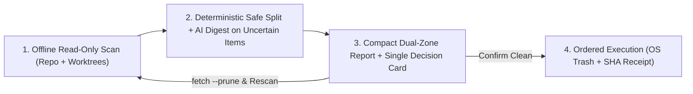

# repo-clean (Low-Friction Repository & Worktree Cleanup)

English | [简体中文](README.zh-CN.md)

> Low-friction Git repository and linked `worktree` cleanup after PR merges or parallel multi-agent tasks. Scans offline and read-only—**isolating 100% deterministic cleanups into `🟢` while pre-digesting squash branches, partial stashes, and AI scratch plans into 1-line `🟡` verdicts with a clear `Keep / Delete` lean**—then executes in safe dependency order with OS Trash and Commit SHA recovery.

## Quick Trigger

- **Full workspace cleanup**: `/repo-clean`, `"repo clean"`, `"clean workspace"`, `"cleanup leftovers"`, `"清理仓库"`, `"清理工作区"`, `"清理中间产物"`
- **Adaptive subset scan**: Asking specifically to clean worktrees or branches (`"清理 worktree"`) automatically narrows scanning to `worktrees + local branches` without reading unrelated scratch docs.

## How It Works



- **Repo-centric boundary & hard protection floor**: Covers only the current repository and checkouts in `git worktree list`; unconditionally protects the active/`locked` worktree, `main`/`master`/`develop`/`release/*`, remote `origin` refs, tracked files (`git ls-files`), `.env*`, active workspace build/dependency caches, and persistent AI configs (`CLAUDE.md`, `AGENTS.md`, `GEMINI.md`, `.cursor/rules/**`).
- **P0 deterministic `🟢` safety split**: Restricts `🟢` strictly to zero-ambiguity items (`> 10 min` idle `prunable`/merged worktrees, `git branch --merged` / `git cherry` patch-equivalent branches, identical stashes, `*.orig`/`*.tmp` leftovers). Heuristic squash/ported branches and narrow AI scratch docs (`PLAN*`, `ANALYSIS*`, `docs/plans/`, etc.—excluding general `SPEC*`/`DESIGN*`/`TODO*` docs) stay in `🟡` with a 1-line AI summary and `(推荐：删 / 留)` recommendation.
- **Recoverable execution order**: Runs `Worktrees → Branches → Stashes (descending index) → Scratch/Temp files`; moves untracked `.md` scratch docs to OS Trash first and prints recovery Commit SHAs for every deleted branch and stash (never running destructive `git gc --prune=now`).

## Installation

```bash
# Option 1: Install via npx skills
npx skills add lastxuanain/ainward-skills

# Option 2: Clone + symlink via scripts/link.sh (see root README for all flags)
git clone https://github.com/lastxuanain/ainward-skills.git ~/ainward-skills
~/ainward-skills/scripts/link.sh --skills repo-clean
```
