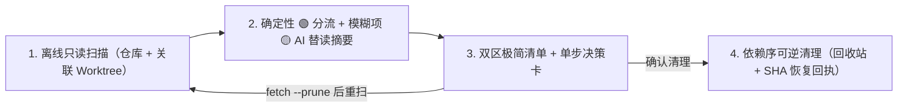

# repo-clean（低心智负担仓库与关联工作区清理）

[English](README.md) | 简体中文

> 面向 PR 合入与并发多 Agent 任务后的低心智负担清理流。纯本地只读盘点当前仓库及 `git worktree list` 关联目录，**将 100% 确定性安全项归入 `🟢` 一键清理，将 Squash 分支、未落盘 Stash 与 AI 推演草稿归入 `🟡` 并附上 1 句后台替读摘要与 `(推荐：删/留)`**，按安全依赖序执行并提供回收站与 Commit SHA 恢复回执。

## 快速触发

- **全量盘点清理**：`/repo-clean` 或 `"清理仓库"`、`"清理工作区"`、`"清理中间产物"`、`"repo clean"`、`"clean workspace"`、`"cleanup leftovers"`
- **按需定向扫描**：仅输入 `"清理 worktree"` 或要求清理分支时，自动收敛扫描范围至 `worktree + 本地分支`，跳过无关文件读取。

## 工作方式



- **严守仓库边界与硬保护底线**：仅覆盖当前仓库与 `git worktree list` 关联检出；无条件保护当前活跃/锁定 worktree、`main`/`master`/`develop`/`release/*`、远端 `origin` 分支、所有 Git 已跟踪文件、`.env*`、主工作区构建依赖缓存及 `CLAUDE.md` / `AGENTS.md` / `GEMINI.md` 等持久化规则配置。
- **P0 确定性安全分流（拒绝误删风险）**：`🟢` 严格限定为 100% 零歧义项（失效/已合入且静置 `>10 分钟` 的 worktree、`git branch --merged` / `git cherry` 全等效分支、完全重复 Stash、`*.orig`/`*.tmp` 等纯残留）；凡需语义判断的 Squash/移植分支与窄匹配 AI 推演稿（`PLAN*`、`ANALYSIS*`、`docs/plans/` 等，不碰 `SPEC*`/`DESIGN*`/`TODO*`）一律留在 `🟡` 由 AI 替读给出 1 句结论与删留建议。
- **依赖序可逆执行**：严格按 `Worktree → 本地分支 → Stash（倒序防偏移）→ 临时推演文件` 执行；未跟踪 `.md` 推演稿优先移入系统回收站，删除分支与 Stash 均在回执附上 `git branch` / `git stash apply` 恢复 SHA（绝不自动执行 `git gc --prune=now`）。

## 安装

```bash
# 方式一：通过 npx skills 安装整套技能
npx skills add lastxuanain/ainward-skills

# 方式二：克隆仓库后通过 link.sh 软链接本技能（详见根目录 README）
git clone https://github.com/lastxuanain/ainward-skills.git ~/ainward-skills
~/ainward-skills/scripts/link.sh --skills repo-clean
```
