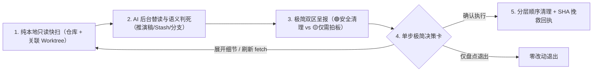

# repo-clean（低心智负担仓库清理与并行残余归整）

[English](README.md) | 简体中文

> 面向远程分支合并与并发多线程开发后的低心智负担仓库清理工作流。先在纯本地只读模式下扫描当前仓库及 `git worktree list` 关联的所有外部 worktree，由 AI 在后台替你读完推演方案、Stash diff 与未合入分支并与主分支比对是否已落地，最后只呈现一份**极简 Result-First 双区清单**（自动折叠保护项、浓缩安全项、只把真正拿不准的条目配上 1 句人话总结与 `推荐删/留` 呈报给你），按依赖顺序执行并保留分层恢复兜底。

## 解决什么问题

每当完成远程分支合入或并发开启多个 AI 线程跑完任务后，仓库周边常积压大量「不删占磁盘、留着污染 AI 上下文」的残余产物：

- **冗余 Worktree 与分支越攒越多**：临时建出的 `sync/*`、`feat/*` worktree（往往各自带着几百 MB 的 `node_modules` 或构建产物），以及经过 PR Squash Merge 或 [`code-sync`](../code-sync/README.zh-CN.md) 语义同步后的本地分支，传统 `git branch --merged` 根本扫不出来；
- **推演草稿与临时文件污染上下文**：散落的 `PLAN*.md`、`ANALYSIS*.md`、`docs/plans/`、合并残留 `*.orig`/`*.patch`，会让后续 AI 检索代码时不断读入过时背景；
- **传统清理清单人工 Review 太累**：如果只是把路径、Stash 名、分支名生硬列成大表格，你还得自己一个个点开看“这文件写了啥、那条 stash 到底合进去了没”；
- **担心误删并发线程或不可逆丢失**：随手删目录怕端掉仍在运行的并行线程，直接 `rm` 未跟踪方案又怕手滑找不回。

`repo-clean` 把“打开文件逐个核对”的阅读成本交给 AI 在后台消化，让你 **5 秒扫一眼即可拍板清理**。

## 快速触发

安装后，在需要清理仓库或并行任务残余时直接输入：

- `/repo-clean`
- 自然语言口令：`清理仓库`、`清理工作区`、`清理分支`、`清理 worktree`、`清理中间产物`、`清理推演文件`

## 工作方式



### 1. 以当前仓库为核心边界，严守保护底线

- **仓库 + 全量关联 Worktree**：基于 `git worktree list` 自动覆盖外部挂载的 worktree（如 `../<repo>-sync-*`、`.worktrees/*`、`~/.claude/worktrees/*`、`~/.codex/worktrees/*`），同时绝不越界扫描其他项目或跨项目全局缓存目录。
- **硬保护折叠降噪（`🔴` 不占篇幅）**：绝不删除 Git 已跟踪正式文件、`.env*`、常规构建/依赖缓存（`node_modules/`、`.venv/`、`dist/` 等，但移除废弃 worktree 时会连带清理其内部缓存）、持久化 AI 规则配置（`CLAUDE.md`、`AGENTS.md`、`GEMINI.md`、`.cursor/rules/**`）、受保护分支（`main`/`master`/`develop`/`release/*`/`HEAD`）以及远端 `origin` 分支——所有保护项仅用 1 行声明略过，绝不刷屏。

### 2. AI 后台替读判死，压缩 `🟡` 人工审查量

- **三层分支合入识别**：结合 `git branch --merged`、上游 `[gone]` + `git cherry` 补丁等效检测，以及语义比对，准确识别 Squash Merge 与 `code-sync` 同步过的分支并直接归入 **🟢 安全清理**。
- **推演文档与 Stash 后台语义核查**：AI 主动读取未跟踪方案文档与 Stash diff——确认对应功能已在主干落地的（哪怕几分钟前刚结束）直接归入 **🟢**；仅将真正未落地代码、未开始方案、有脏改/锁定、`<= 10 分钟` 极近期热修改保留在 **🟡 需拍板**，并用 **1 句人话总结内容 + 给出 `推荐：删 / 留`**。

### 3. 单步极简拍板与分层可逆执行

- **一屏决策卡**：支持一键清理全部 `🟢`、一键清理 `🟢 + AI 推荐可删项`、按编号微调、预览某项原文/diff，或按需执行一次 `git fetch --prune` 同步刚合并完的线上 PR 状态后再重扫。
- **安全依赖序 + 双重后悔药**：按 **Worktree → 本地分支 → Stash（倒序 drop 防下标偏移）→ 中间文件 → 可选 `remote prune`** 的安全顺序执行；未跟踪推演/方案文件优先移入**系统回收站**，已删除分支与 Stash 在最终回执附上完整 **Commit SHA 恢复指令**（不自动跑会清除 reflog 的 `git gc --prune=now`）。

## 安装

### 方式一：使用 `npx skills`

```bash
npx skills add lastxuanain/ainward-skills
```

### 方式二：Git 克隆 + 软链接

```bash
git clone https://github.com/lastxuanain/ainward-skills.git ~/ainward-skills

# Antigravity
mkdir -p ~/.gemini/config/skills
ln -s ~/ainward-skills/skills/repo-clean ~/.gemini/config/skills/repo-clean

# Claude Code
mkdir -p ~/.claude/skills
ln -s ~/ainward-skills/skills/repo-clean ~/.claude/skills/repo-clean

# Codex
mkdir -p ~/.codex/skills
ln -s ~/ainward-skills/skills/repo-clean ~/.codex/skills/repo-clean

# Cursor
mkdir -p ~/.cursor/skills
ln -s ~/ainward-skills/skills/repo-clean ~/.cursor/skills/repo-clean
```
