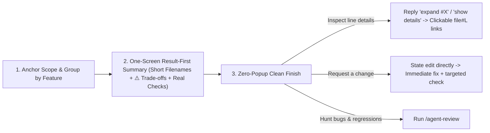

# work-report (Result-First Change Walkthrough)

English | [简体中文](README.zh-CN.md)

> Result-First, low-friction change walkthrough after implementing or modifying code: gives you **one scannable screen** in plain peer-engineer language—covering what changed (with short filenames, hiding `#L` clutter), candid compromises/assumptions (`⚠️`), and real verification status—without repeating biased self-reviewed call-chain checks (left to [`agent-review`](../agent-review/README.md)) or trapping you in turn-by-turn modal popups.

## The Problem

After an agent finishes writing or updating code, developers typically run into one of two bad extremes—an opaque wall of optimistic prose, or a tedious multi-turn approval ceremony:

- **Modal click fatigue**: Having to click through 4–5 consecutive confirmation popups just to read what changed across a few modules;
- **Buried shortcuts & unrun checks**: Silent workarounds, hardcoded assumptions, or skipped tests getting lost inside verbose formatting boilerplate;
- **Overlapping self-reviews**: Asking the same coding session to assert `"no downstream impact"` wastes time and suffers from confirmation bias—independent bug and regression hunting belongs in [`agent-review`](../agent-review/README.md).

`work-report` makes change handoffs **fast to scan, honest about shortcuts, and effortless to adjust**.

## Quick Trigger

After an agent writes or modifies code, run in chat:

- **Walk through current session or workspace changes**: `/work-report`, `"work report"`, `"walk me through the changes"`, `"brief me on the changes"`, `"向我汇报"`, `"汇报一下这次改动"`
- **Scope to specific paths or commits**: `/work-report src/auth/`, `/work-report HEAD~2..HEAD`
- **Optional step-by-step mode**: include `"walk through one by one"` / `"一步一步讲"` when you explicitly want sequential paging

## How It Works



### What Fits on the Default Screen

1. **1–2 Line Headline** — completion status, module/file count, and overall test status.
2. **Cohesive Change Digest (`#1..#N`)** — grouped by functional boundary with **short filenames** (hiding `#L` line numbers and symbol walls by default), explained in 1–3 plain sentences; supporting wiring/config stays 1 tight line.
3. **Candid Trade-offs & Assumptions (`⚠️`)** — surfaced only when compromises, hardcoded fallbacks, or implicit assumptions exist (omitted completely when clean).
4. **Honest Verification Status** — reports observed run results only; marks anything unrun as `Not verified: <reason>`.
5. **Needs Attention (omitted when clean)** — aggregates all `⚠️` compromises and unverified checks in one quick-scan spot.

### Zero-Popup Closing + Direct Edit Loop

- **No modal confirmation gates**: finishes cleanly with a 1-line closing hint so you keep full momentum.
- **Drill down on demand**: reply `"expand #2"` or `"show details"` to surface clickable `file#L` line links and detailed before/after code paths anytime.
- **Direct follow-up edits**: ask to tweak an item directly in chat and the agent applies the change, runs targeted verification, and replies concisely—zero multi-step list-staging ceremony.

## Installation

### Option 1: Install via `npx skills`

```bash
npx skills add lastxuanain/ainward-skills
```

### Option 2: Git Clone + Symlink

```bash
git clone https://github.com/lastxuanain/ainward-skills.git ~/ainward-skills

# Antigravity
mkdir -p ~/.gemini/config/skills
ln -s ~/ainward-skills/skills/work-report ~/.gemini/config/skills/work-report

# Claude Code
mkdir -p ~/.claude/skills
ln -s ~/ainward-skills/skills/work-report ~/.claude/skills/work-report

# Codex
mkdir -p ~/.codex/skills
ln -s ~/ainward-skills/skills/work-report ~/.codex/skills/work-report

# Cursor
mkdir -p ~/.cursor/skills
ln -s ~/ainward-skills/skills/work-report ~/.cursor/skills/work-report
```
