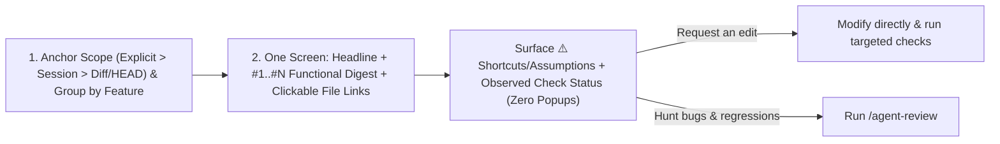

# work-report (One-Screen Change Walkthrough)

English | [简体中文](README.zh-CN.md)

> Candid, low-friction **one-screen code change walkthrough**: groups completed edits by functional boundary with clickable `[file.ts](file:///...#L...)` basename links, **surfaces `⚠️` shortcuts/assumptions and real check status upfront**, and finishes cleanly with zero modal popups.

## The Problem

- **Optimistic prose burying shortcuts**: Verbose summaries hide hardcoded workarounds, implicit assumptions, and skipped checks inside file walls;
- **Popup & drill-down friction**: Clicking through sequential confirmation cards or spending an extra turn just to get clickable source line links;
- **Biased self-reviews**: Asking the authoring session to claim `"no downstream regressions"` suffers from confirmation bias (independent regression audits belong in [`agent-review`](../agent-review/README.md)).

## Quick Trigger

After implementing or modifying code, run in chat:

- `/work-report` or natural language: `"work report"`, `"walk me through the changes"`, `"brief me on the changes"`, `"工作汇报"`, `"向我汇报"`, `"汇报一下这次改动"`
- Scoped walkthrough: `/work-report src/auth/`, `/work-report HEAD~2..HEAD`
- Optional sequential paging: ask explicitly to `"walk through one by one"`

## How It Works



- **Clickable basename links in 0 extra turns**: Groups changes cohesively (`#1..#N`, compressing minor wiring into 1 tight `[配套]` bullet) with compact `[basename.ts](file:///...#L...)` links—clean visual text that jumps straight to exact lines.
- **Upfront candor & honest verification**: Highlights `⚠️` compromises/assumptions once right where they occur (omitted when clean) and reports strictly observed test results vs. `Not verified: <reason>`.
- **Zero modal gates + direct edits**: Stops cleanly without modal popups or robotic footers; ask for tweaks directly in chat to edit and re-verify on the spot.

## Installation

Install via `npx skills add lastxuanain/ainward-skills`, or clone the repo and run [`../../scripts/link.sh`](../../scripts/link.sh):

```bash
./scripts/link.sh
```
