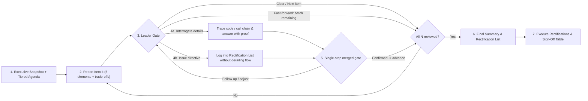

# work-report (工作汇报)

English | [简体中文](README.zh-CN.md)

> Paced, item-by-item work report and interactive code walkthrough: the agent briefs you like an accountable engineer reporting to a technical lead—opening with an executive snapshot and tiered agenda, presenting clickable code evidence and hidden trade-offs, answering interrogations with call-chain proof, logging directives without derailing flow, and closing with a consolidated Rectification List (`整改清单`) and sign-off execution.

## The Problem

When an AI agent finishes implementing a feature or modifying multiple modules, it typically dumps a long, optimistic wall of text. As the technical decision-maker, you run into three recurring pain points:

- **Cognitive overload & lost context**: Prose summaries gloss over critical details, while raw `git diff` hunks bury architectural flow under scattered line edits;
- **Hidden assumptions & silent shortcuts**: Unstated design trade-offs, implicit assumptions, or band-aid workarounds get rationalized away instead of surfaced;
- **Derailed review flow**: Pointing out an issue in module 2 causes the agent to immediately start rewriting code, leaving modules 3–6 completely unreviewed.

`work-report` turns post-change review into a **leader-paced interactive walkthrough** (and pairs naturally with [`agent-review`](../agent-review/README.md): `agent-review` runs an isolated subagent audit to hunt bugs, while `work-report` aligns human understanding and captures your exact architectural directives).

## Quick Trigger

After an agent finishes writing or modifying code, trigger the workflow in chat:

- **Brief current session or workspace changes**: `/work-report`, `"work report"`, `"walk me through the changes"`, `"brief me on the changes"`, `"step-by-step report"`, `"向我汇报"`, `"逐项汇报"`
- **Brief a specific scope**: `/work-report src/auth/`, `/work-report HEAD~2..HEAD`

## How It Works

`work-report` anchors the target scope, groups changes along architectural boundaries into `N` items tagged `Core` or `Supporting` (scaling depth proportionally with zero boilerplate), and presents **one item per turn** by default—with built-in **fast-forward batching** and **free-jump navigation** whenever you want to speed through supporting items:



### Each briefing item covers 5 elements (scaled by `Core` vs. `Supporting` tier)

1. **Scope & Location** — added, modified, or deleted files and exact symbols with clickable line-range links.
2. **Core Change & Key Trade-offs** — concise before vs. after comparison explaining *what* changed and *why*, **proactively surfacing architectural trade-offs, implicit assumptions, or shortcut compromises** rather than self-justifying them.
3. **Call-Chain & Impact** — upstream callers, downstream dependencies, and shared utilities touched, stating *how* they were checked (never a bare `"no impact"`).
4. **Verification Status** — candid report of checks already executed vs. items marked `Not verified: <reason>` (read-only and low-latency by default).
5. **Progress & Logged Directives** — `Item k of N` plus the running count of recorded rectification items.

### Final Deliverable & Closed-Loop Sign-Off (`《工作汇报总结与整改清单》`)

Once all items are reviewed, the agent outputs a complete summary directly in chat:

- **Briefing Overview Table** — tier and final review status of all `N` items (`Approved`, `Approved (Batched)`, `Approved after Q&A`, `Rectification Required`, or `Fixed Inline`).
- **Interrogation & Verification Minutes** — key questions raised during the walkthrough and verified code conclusions.
- **Leader Directives & Rectification List (`整改清单`)** — numbered action items with target locations, your directive, and concrete modification plans.
- **Unverified Items & Residual Risks** — unrun checks, surfaced assumptions, or remaining edge cases.
- **Tracked Execution & Sign-Off** — prompts whether to execute the Rectification List right away; when approved, applies `#1..#M` in order, runs targeted checks, and replies with a **Rectification Sign-Off Table (`整改核销回执表`)**.

## Installation

### Option 1: Install via `npx skills`

```bash
npx skills add lastxuanain/ainward-skills
```

### Option 2: Git Clone + Symlink

```bash
git clone https://github.com/lastxuanain/ainward-skills.git ~/ainward-skills

# Antigravity
mkdir -p ~/.gemini/config/skills
ln -s ~/ainward-skills/skills/work-report ~/.gemini/config/skills/work-report

# Claude Code
mkdir -p ~/.claude/skills
ln -s ~/ainward-skills/skills/work-report ~/.claude/skills/work-report

# Codex
mkdir -p ~/.codex/skills
ln -s ~/ainward-skills/skills/work-report ~/.codex/skills/work-report

# Cursor
mkdir -p ~/.cursor/skills
ln -s ~/ainward-skills/skills/work-report ~/.cursor/skills/work-report
```
