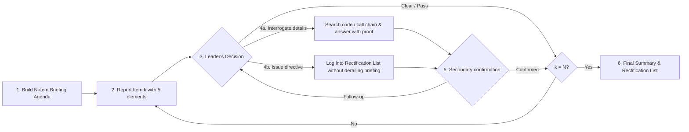

# work-report (工作汇报)

English | [简体中文](README.zh-CN.md)

> Structured item-by-item work report and code review retrospective: the agent reports completed changes like an engineer briefing a technical lead, answers interrogations with code evidence, logs directives, and produces a consolidated Rectification List (`整改清单`).

| Field | Value |
|-------|-------|
| Status | `experimental` |
| Version | 1.0.0 |
| Categories | Agent workflow · Engineering governance · Software engineering |
| Verified on | Antigravity |

## The problem

When an AI agent finishes implementing a feature or modifying multiple modules, it typically dumps a long, one-shot summary. As the decision-maker, you are left with a passive wall of text: it is hard to grasp the true progress of the session, verify whether shared components or callers were broken, interrogate specific design choices, or systematically track follow-up fixes.

## How it works

`work-report` puts the agent in the role of a **subordinate engineer reporting completed work to a leader**, one logical item at a time:



### Each briefing item includes 5 elements

1. **Scope & Location** — files added, modified, or deleted, and the symbols involved, with clickable line-range links.
2. **Core Change** — concise before vs. after comparison explaining *what* changed and *why*.
3. **Call-Chain & Impact** — upstream callers, downstream dependencies, shared utilities touched, and how they were checked.
4. **Verification Status** — candid report of checks already run vs. items marked `Not verified: <reason>` (no unprompted slow test runs stalling the briefing).
5. **Progress & Logged Directives** — `Item k of N` plus the running count of recorded rectification items.

### Final deliverable (`《工作汇报总结与整改清单》`)

After all $N$ items are reviewed, the agent outputs a complete summary directly in the conversation:

- **Briefing Overview Table** — status of all $N$ items (`Approved`, `Approved after Q&A`, or `Rectification Required`).
- **Interrogation & Verification Minutes** — key questions asked by the leader and the verified findings.
- **Leader Directives & Rectification List (`整改清单`)** — numbered action items with target locations, the leader's directive, and concrete modification plans.
- **Unverified Items & Residual Risks** — remaining unverified checks or edge cases.
- **Next-Step Prompt** — asks whether to immediately execute the Rectification List or conclude the briefing.

## Install

```bash
git clone https://github.com/lastxuanain/ainward-skills.git ~/ainward-skills

# Antigravity (verified)
ln -s ~/ainward-skills/skills/work-report ~/.gemini/config/skills/work-report
```

For other agents supporting the [Agent Skills](https://agentskills.io) format, link or copy the folder into that agent's skills directory.

## Usage

- Slash command: `/work-report`
- Natural language: `"work report"`, `"walk me through the changes"`, `"brief me on the changes"`, `"step-by-step report"`, `"工作汇报"`, `"向我汇报"`, `"逐项汇报"`, `"汇报一下这次改动"`, `"复盘一下代码"`

## Changelog

- **1.0.0**: Initial release.
