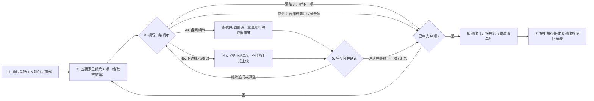

# work-report（工作汇报）

[English](README.md) | 简体中文

> 面向已完成或改过代码的交互式工作汇报与代码走读工作流：让 Agent 像严谨担责的工程师向技术负责人汇报一样，先给全局总括与分层提纲，再带代码证据与设计取舍逐项呈报进展、接受细节盘问、记录修改批示，最终输出《工作汇报总结与整改清单》并支持按单核销整改。

## 解决什么问题

当 Agent 写完或改完一批代码后，通常只会甩出一长篇“报喜不报忧”的流水账总结。作为把关的技术负责人，你往往面临三大痛点：

- **认知过载与细节失控**：看文字总结觉得“好像都改对了”，看原始 `git diff` 又容易陷入碎片代码而迷失主线；
- **隐式假设与妥协被掩盖**：AI 实现时擅自做出的方案取舍、默认假设或临时补丁不会被主动提及；
- **边审边改导致对话脱轨**：一旦指出第 2 个模块有问题，AI 就立刻埋头改代码，导致后面第 3～6 个模块彻底失审。

`work-report` 将代码验收变成一场**由你掌控节奏的交互式过堂汇报**（可与独立全链路找茬的 [`agent-review`](../agent-review/README.zh-CN.md) 配合使用：一个负责客观挑刺，一个负责认知对齐与拍板收口）。

## 快速触发

安装后，在 Agent 完成代码修改的对话或工作区中直接输入：

- **汇报本轮对话或工作区改动**：`/work-report` 或「工作汇报」「向我汇报」「逐项汇报」「汇报一下这次改动」「复盘一下代码」
- **指定范围汇报**：`/work-report src/auth/`、`/work-report HEAD~2..HEAD`

## 工作方式

`work-report` 让 Agent 进入**「下属向技术负责人汇报工作」**的状态机：智能锚定变更范围，按架构内聚划分为 `N` 项（区分 `核心 Core` 与 `配套 Supporting`，详略得当、拒绝八股），默认每次汇报 **1 项**，同时支持随时**快进合并过堂**或**点名跳项**：



### 每项汇报固定覆盖 5 个要素（按 `核心 / 配套` 自动缩放详略）

1. **改动定位** — 涉及的新增、修改、删除文件及具体函数/类/组件（附可点击的文件与行号链接）。
2. **核心变更逻辑与设计取舍** — 改前 vs 改后的关键逻辑对比，并**主动暴露方案取舍、隐式假设或妥协写法**（严禁把临时补丁美化成合理设计）。
3. **上下游影响面核查** — 上游调用方、下游依赖方及横向公共复用组件核查结论，必须交代检索依据，拒绝空口一句“无影响”。
4. **验证与自测情况** — 基于本轮已实跑的测试/编译结果如实汇报（默认只读不卡顿）；未跑过的检查坦诚标记为 `Not verified: <原因>`。
5. **汇报进度与累计批示** — 清晰标注 `Item k of N` 及当前已记录的整改项数量。

### 最终产出与闭环（《工作汇报总结与整改清单》）

当全部事项过堂完毕后，Agent 会在对话中汇总整场汇报成果并衔接落地：

- **全局汇报总览表** — 全部 `N` 项的级别与审查状态（直接通过 / 合并过堂通过 / 盘问核实通过 / 需整改 / 已当场修改）。
- **盘问与核实纪要** — 浓缩汇报过程中追问的关键问题与代码查证结论。
- **领导批示与整改清单（Action Items）** — 逐条列出 `#编号`、目标模块与行号位置、批示内容及具体整改方案。
- **未验证项与残留风险** — 汇总尚未实跑验证的环节、已暴露的隐式假设或边界风险。
- **一键按单整改与核销回执** — 若存在待整改项，主动请示是否立即按《整改清单》执行；批准后按序修改、靶向验证，并输出《整改核销回执表》逐条销账。

## 安装

### 方式一：使用 `npx skills`

```bash
npx skills add lastxuanain/ainward-skills
```

### 方式二：Git 克隆 + 软链接

```bash
git clone https://github.com/lastxuanain/ainward-skills.git ~/ainward-skills

# Antigravity
mkdir -p ~/.gemini/config/skills
ln -s ~/ainward-skills/skills/work-report ~/.gemini/config/skills/work-report

# Claude Code
mkdir -p ~/.claude/skills
ln -s ~/ainward-skills/skills/work-report ~/.claude/skills/work-report

# Codex
mkdir -p ~/.codex/skills
ln -s ~/ainward-skills/skills/work-report ~/.codex/skills/work-report

# Cursor
mkdir -p ~/.cursor/skills
ln -s ~/ainward-skills/skills/work-report ~/.cursor/skills/work-report
```
