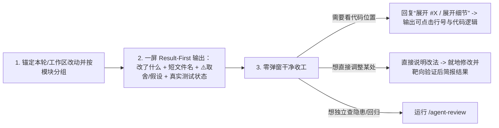

# work-report（改动交底与走读）

[English](README.md) | 简体中文

> 面向普通开发者的 `Result-First` 低打扰改动走读工作流：用平级协作的大白话**一屏呈现**改了什么、哪里做了妥协或隐式假设、实际测了哪些没测哪些；不搞“逐项弹窗过堂”、不堆 `#L` 行号墙、不重复做有偏见的自我调用链审查（把找茬交给独立子 Agent 的 [`agent-review`](../agent-review/README.zh-CN.md)），零弹窗收工并支持按需展开细节或直接开口修改。

## 解决什么问题

写完或改完一批代码后，开发者最常遇到两类极端体验——要么 AI 甩出一长篇报喜不报忧的流水账，要么每改两个模块就搞多轮弹窗逐项过堂、点到手软：

- **连环弹窗太繁琐**：不想为看清 3～4 个模块的改动连续点四五轮“确认继续”；
- **隐式妥协与未测项被稀释**：设计取舍、硬编码兜底或根本没跑通的测试，常常藏在大段描述和文件清单中间；
- **职责重叠与形式主义**：同一个写代码的 Agent 在汇报里顺手自评“无下游影响”既耗时又不可靠，本应交给独立的 [`agent-review`](../agent-review/README.zh-CN.md)。

`work-report` 把“改动交底”回归到**一眼看懂、直指风险、随口能改**的轻量交互体验。

## 快速触发

在完成代码修改的对话或工作区中直接输入：

- **走读本轮对话或工作区改动**：`/work-report` 或「工作汇报」「向我汇报」「汇报一下这次改动」「复盘一下代码」
- **指定范围走读**：`/work-report src/auth/`、`/work-report HEAD~2..HEAD`
- **想要逐项慢慢看**（可选）：在触发时或展开时加上「一步一步讲」即可切换为逐项展开模式

## 工作方式



### 默认一屏包含什么（内严外浅、去噪音）

1. **改动总括（1～2 句）** — 目标完成度、共涉及几块功能与几个文件、整体验证结论。
2. **分组改动说明（`#1..#N`）** — 按功能模块内聚拆分，每项展示**短文件名**（默认隐藏 `#L` 行号与类名堆砌），用 1～3 句人话讲清改前改后变化；`配套`改动浓缩为 1 行。
3. **直白暴露的取舍与假设（`⚠️`）** — 仅当存在临时变通、硬编码阈值或隐式前提时显眼标出，绝不把凑合方案包装成“最佳实践”；干净改动直接省略该行。
4. **真实验证状态** — 仅汇报实际跑过并看到输出的结果；没跑的检查坦诚写明 `未验证（原因）`。
5. **需要留意的点（无风险时整块省略）** — 把所有 `⚠️` 妥协和未验证项集中置顶/汇总，扫一眼就能拍板。

### 零弹窗收工 + 直接改代码闭环

- **默认不弹确认卡**：一屏看完即可继续干活，文末仅附 1 行提示。
- **按需展开**：回复 `展开 #2` 或 `展开细节`，立刻调出对应模块的可点击 `file#L` 行号链接与详细逻辑对比。
- **随口直改**：如果觉得某处设计不合适，直接说出改法，Agent 会**就地修改并做靶向验证**，不再多一道“先记清单、再点确认执行、再出核销表”的冗余回合。

## 安装

### 方式一：使用 `npx skills`

```bash
npx skills add lastxuanain/ainward-skills
```

### 方式二：Git 克隆 + 软链接

```bash
git clone https://github.com/lastxuanain/ainward-skills.git ~/ainward-skills

# Antigravity
mkdir -p ~/.gemini/config/skills
ln -s ~/ainward-skills/skills/work-report ~/.gemini/config/skills/work-report

# Claude Code
mkdir -p ~/.claude/skills
ln -s ~/ainward-skills/skills/work-report ~/.claude/skills/work-report

# Codex
mkdir -p ~/.codex/skills
ln -s ~/ainward-skills/skills/work-report ~/.codex/skills/work-report

# Cursor
mkdir -p ~/.cursor/skills
ln -s ~/ainward-skills/skills/work-report ~/.cursor/skills/work-report
```
