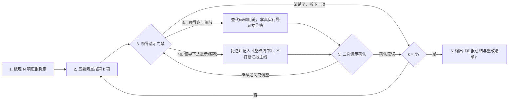

# work-report（工作汇报）

[English](README.md) | 简体中文

> 面向已完成或改过代码的交互式工作汇报与复盘工作流：让 Agent 像下属向技术负责人汇报工作一样逐项呈报进展、接受盘问、记录批示，最终汇总成完整的《工作汇报总结与整改清单》。

## 解决什么问题

当 Agent 写完或改完一批代码功能后，通常只会甩出一长篇流水账总结。作为把关的负责人，你很难通过这一大段文字真正掌控本轮对话的全局进展，既不方便针对某个模块深入盘问细节（如“为什么这么改？”“会不会影响其他调用方？”），也没法在听取汇报的过程中顺畅地下达修改批示、最后收拢出一份清晰的整改清单。

## 快速触发

安装后，在 Agent 完成代码修改的对话中直接输入：

- **斜杠命令**：`/work-report`
- **自然语言口令**：「工作汇报」「向我汇报」「逐项汇报」「汇报一下这次改动」「复盘一下代码」「walk me through the changes」

## 工作方式

`work-report` 让 Agent 进入**「下属向领导逐项汇报工作」**的角色：先把已改完的功能梳理成 $N$ 项汇报提纲，每次只汇报 **1 项**，由你全程掌控节奏、盘问细节或下达批示：



### 每项汇报固定包含 5 个要素

1. **改动定位** — 涉及的新增、修改、删除文件及具体方法/组件（附可点击的文件与行号链接）。
2. **核心实现与变更逻辑** — 改前 vs 改后的核心代码差异，讲清楚改了什么、为什么这么改。
3. **上下游影响面核查** — 上游调用方、下游依赖方、是否触及公共组件/共享模块、是否对其他端有副作用，并说明检索核查依据。
4. **验证与自测情况** — 基于已执行过的测试/编译结果如实汇报（流畅不卡顿）；未跑过的检查坦诚标记为 `Not verified` 并说明原因，绝不瞒报。
5. **汇报进度与累计批示** — 清晰标注 `第 k 项（共 N 项）` 及当前已记录的整改项数量。

### 最终产出（《工作汇报总结与整改清单》）

当全部 $N$ 项汇报完毕后，Agent 会在对话中直接汇总整场汇报与批示成果：

- **全局汇报总览表** — 全部 $N$ 项的审查结论（直接通过 / 盘问核实通过 / 需整改）、涉及文件与核心摘要。
- **盘问与核实纪要** — 浓缩汇报过程中追问的关键问题与代码查证结论。
- **领导批示与整改清单（Action Items）** — 逐条列出 `#编号`、关联模块与代码位置、批示内容、具体整改落地方案。
- **未验证项与残留风险** — 汇总尚未验证的环节或潜在边界风险。
- **后续动作请示** — 若存在整改项，主动请示是否**立即按《整改清单》开始执行修改**。

## 安装

### 方式一：使用 `npx skills`

```bash
npx skills add lastxuanain/ainward-skills
```

### 方式二：Git 克隆 + 软链接

```bash
git clone https://github.com/lastxuanain/ainward-skills.git ~/ainward-skills

# Antigravity
mkdir -p ~/.gemini/config/skills
ln -s ~/ainward-skills/skills/work-report ~/.gemini/config/skills/work-report

# Claude Code
mkdir -p ~/.claude/skills
ln -s ~/ainward-skills/skills/work-report ~/.claude/skills/work-report

# Codex
mkdir -p ~/.codex/skills
ln -s ~/ainward-skills/skills/work-report ~/.codex/skills/work-report

# Cursor
mkdir -p ~/.cursor/skills
ln -s ~/ainward-skills/skills/work-report ~/.cursor/skills/work-report
```
