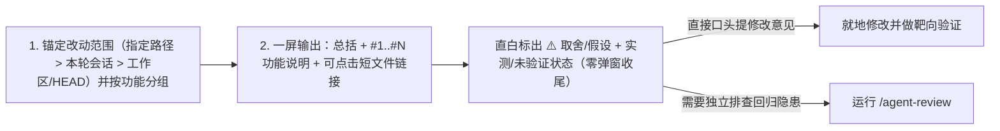

# work-report（改动交底与走读）

[English](README.md) | 简体中文

> 平级、坦诚的**一屏改动交底工作流**：按功能边界聚合已完成或修改的代码，附上可点击直达源码的 `[file.ts](file:///...#L...)` 短文件名链接，**直白暴露 `⚠️` 临时变通/隐式假设与真实验证状态**，零弹窗干净收工。

## 解决什么问题

- **流水账掩盖风险**：大段报喜不报忧的文字墙，把临时硬编码兜底、隐式前提或根本没跑的测试藏在文件清单深处；
- **连环弹窗与多轮翻页**：看几个模块的改动还要逐项点确认，或者想看源码位置还得再打字追问一轮行号；
- **自我审查偏见混杂**：写代码的同一会话顺手自夸「无下游影响」既耗时又不可靠（独立找茬应交给 [`agent-review`](../agent-review/README.zh-CN.md)）。

## 快速触发

在完成代码修改的会话或工作区中输入：

- `/work-report` 或自然语言：`工作汇报`、`向我汇报`、`汇报一下这次改动`、`work report`、`walk me through the changes`、`brief me on the changes`
- 指定范围：`/work-report src/auth/`、`/work-report HEAD~2..HEAD`
- 可选逐项走读：显式说明「一步一步讲」时切换为逐项展开

## 工作方式



- **一屏直达源码**：按模块内聚呈现 `#1..#N`（`配套`改动浓缩为 1 行），所有文件均带可点击 `[basename.ts](file:///...#L...)` 锚点，零路径噪音、一步直跳对应行。
- **坦白妥协与真实测试**：仅在存在临时绕行、硬编码或隐式假设时就地标出 `⚠️`（干净改动直接省略，不重复刷多遍汇总）；严格区分实跑通过与 `未验证：<原因>`。
- **零弹窗收工 + 随口直改**：不弹任何确认卡、不刷机械尾注；如需调整某处实现，直接说明改法即可就地修改并跑靶向验证。

## 安装

使用 `npx skills add lastxuanain/ainward-skills`，或克隆仓库后运行根目录一键软链接脚本 [`../../scripts/link.sh`](../../scripts/link.sh)：

```bash
./scripts/link.sh
```
